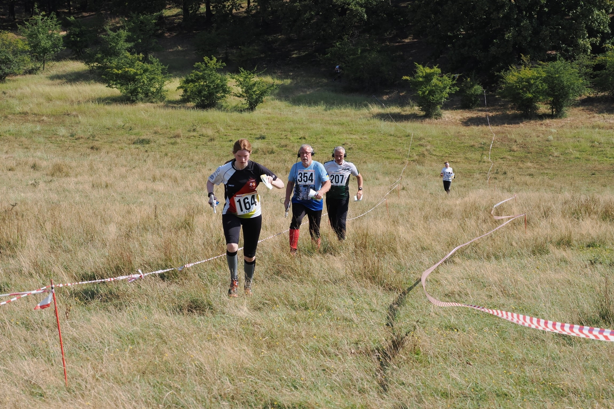
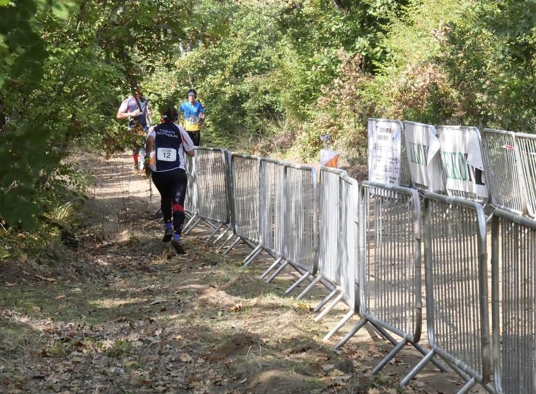

# Koridory

Koridorem se rozumí jasně vyznačený úsek trati, který je určen pro navádění závodníka. Jeho délka dle pravidel nesmí přesáhnout 400 m. Typickými použitími koridorů jsou například startovní a cílový koridor, které slouží k vyvedení závodníka od startu a navedení do cíle a odběhový koridor od divácké kontroly. Další možnost použití koridoru je překonání nebezpečného úseku, například přeběh silnice v prostředku závodního prostoru.

Koridory by se při závodě mělo spíše šetřit, zejména těmi oboustrannými, jejichž překonávání znamená diskvalifikaci. Stejně tak by všechny typy koridorů měly být výrazně vyznačené včetně jejích konců, aby závodník věděl, zda běží správně.

## Druhy koridorů
Koridory se rozlišují podle dvou typů:
- Podle značení
  - **Přerušovaný a jednostranný koridor** -- značen fáborky v rozestupech, či souvislou bariérou (např. páskou) na jedné straně. Takový koridor je možné překonávat a mimo startovní koridor jej není nutné dodržet.
  - **Oboustranně souvisle značený koridor** -- značen oboustranně, souvisle a nad zemí. Při splnění těchto podmínek je nutné jej dodržet v celé délce a je zakázáno ho překonávat.

- Podle účelu
  - **Startovní** -- slouží k vyvedení závodníka od startu do závodního prostoru. Musí být dodržen až do konce, přičemž by jeho konec měl být jasně označen (ideálně cedulí Konec koridoru).
  - **Cílový** -- slouží k navedení závodníka od majáku na cílovou čáru a jeho druh a délka musí být uvedeny v pokynech.
  - **Průběhový** -- slouží k navedení závodníka v diváckém nebo jiném prostoru, kde by bez značení nemuseli mít všichni závodníci stejné podmínky.

*Příklad oboustranně souvislého cílového koridoru, vyznačeného páskou. Koridor je natažený v celé délce nad zemí -- jeho překonání by vedlo k diskvalifikaci.*

*Pokud závodník přibíhá od cíle, musí oboustranný cílový koridor oběhnout až k majáku a až poté do něj smí vběhnout.*
