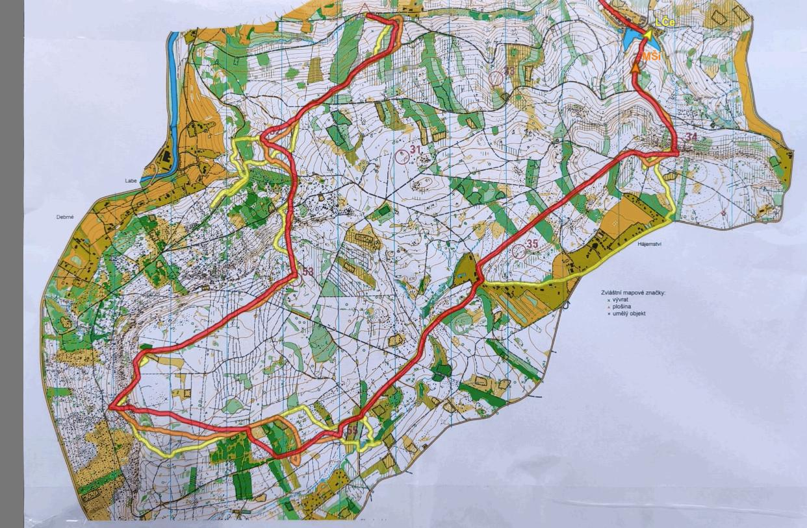

# Spolupráce
Podle pravidel ROB "závodník pod trestem diskvalifikace nesmí během závodu vzájemně spolupracovat s dalšími závodníky". Spoluprácí se rozumí vědomé předávání informací na trati (například umístění kontrol, pozice na mapě, pořadí atd.). Při posuzování spolupráce by se měly brát v úvahu další okolnosti -- pokud závodník ukáže polohu na mapě ztracenému dítěti v kategorii MD12, tak to má mnohem menší dopad než prozrazení lokace kontroly mezi závodníky M20.

Jako spolupráci nelze označit pouhé seběhy ve stejných časech na kontrolách, jelikož elitní závodníci volí často stejné postupy bez ohledu na ostatní anebo jim postupy trvají přibližně podobné množství relací, i když každý běžel jinudy. Stejně tak pokud jeden závodník doběhl druhého, je velice těžké jej setřást. V tomto případě je důležité spíše sledovat případnou komunikaci (ať už verbální, či pouze ukazováním či podobným způsobem).

Před diskvalifikací je důležité si být vždy jistý, že k spolupráci opravdu docházelo, nikoliv se pouze domnívat -- zbytečná diskvalifikace na základě dohadů bude připadat závodníkům neférová. Ideální je, pokud byli závodníci viděni na trati přímo rozhodčím, což ovšem většinou nebývá ten případ.

*Příklad seběhů na trati (start byl intervalový). Je vidět, že se závodníci seběhli mezi první a druhou kontrolou a následně místy běželi spolu, jelikož tak vedl optimální postup. V tomto případě budou mezičasy podobné, ale o spolupráci se nejednalo.*
