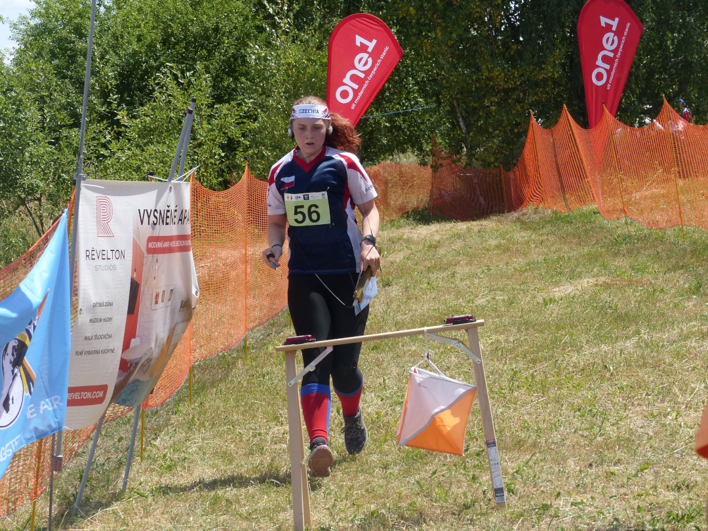

# Rozpočet
Rozpočet akce je potřeba stanovit s ohledem na vynaložené náklady při zachování adekvátní rezervy. Plánování tedy obnáší stanovení všech předpokládaných výdajů ze soutěže s možnými dalšími příjmy (dotace, sponzoring) a následné stanovení ceny samotného startovného. Ubytování většinou bývá řešeno separátně za domluvené ceny, ale je nutné počítat s částkou za ubytování pořadatelů a s obvyklou nutností složení zálohy.

## Náklady na soutěž

Následující seznam obsahuje běžné nákladové položky při soutěži, vždy však záleží na konkrétní situaci -- někdy je pořadatel schopen některé z nich dostat zadarmo, či se naopak vyskytne jiná položka.

- **Mapové podklady** -- většina OB klubů si za poskytnutí mapových podkladů účtuje buď částku za závodníka (obvykle cca 20-40 Kč), nebo rovnou paušál za celou mapu. Částky se mění podle konkrétního klubu, komplexnosti, stáří a rozsahu mapy.
- **Platby za povolení do lesa / využití pozemků** -- některé lesní správy požadují poplatek za povolení konání soutěže v daném lesním prostoru (např. lesy okolo Písku), stejně tak v případě umístění cíle / parkoviště na soukromý pozemek bývá zvykem majiteli platit.
- **Doprava** -- pokud se závodníci na start nedopravují individuálně, je nutné částku za autobusovou či jinou přepravu připočítat do nákladů.
- **Materiál** -- tisky map, spotřební materiál či další specifické vybavení pro soutěž
- **Palivo** -- je potřeba počítat s návštěvami prostoru předem, dovozem materiálu a při samotné soutěži s dopravou pořadatelů a převozu věcí závodníků.
- **Diplomy a ceny** -- obvykle je zvykem dávat medaile i na soutěžích NŽ mimo MČR. Pro ceny lze velmi dobře využít výrobky sponzorů.
- **Mobilní WC** -- pro závody ROB obvykle stačí 1 či max. 2 toalety. Vhodným rozložením startů a cílů se dá ušetřit náklady za převoz.
- **Občerstvení** -- štáva do cíle (případně i sušenky)
- **Náklady na pořadatele** -- ubytovací náklady včetně stravy + strava přímo během soutěže (obsluhy v lese bývají klidně celý den v případě více závodů). Ubytování pořadatelů je možné řešit odděleně od závodníků.
- **Pozornosti pro závodníky** -- pokud je zájmem pořadatele vyrobit upomínkové předměty (např. magnety, samolepky atd.), je potřeba s tímto plánovat už při návrhu rozpočtu.

Všechny tyto náklady je nutné sečíst, připočítat dostatečnou rezervu a následně stanovit cenu startovného. Je lepší raději trochu nadsadit a pak případně peníze vracet, než skončit se ztrátou.  

## Dotace a sponzoring
Některé obce poskytují dotace na konání sportovních akcí v jejich regionech či pro kluby se sídlem v dané obci. V případě větších měst je dosáhnout na dotaci náročnější, ale vyplatí se to alespoň zkusit. Je důležité si pohlídat správná data podání žádostí a potřebné dokumenty. Dokud není dotace potvrzená, nemělo by se s ní plánovat v příjmech.

Druhou možností získání příjmů je přes soukromé společnosti. Ty obvykle nerady dávají samotné finanční prostředky, ale mnohem častěji kývnou na poskytnutí svých produktů, či případně poskytnutí lepší ceny. Takto se dá ušetřit například na cenách pro závodníky, pokud je sponzorem obchod se sportovním zbožím, či na občerstvení díky firmě na sušenky atd.

Vždy je dobré komunikovat přes případné osobní kontakty, než oslovovat cizího zástupce. Je potřeba si uvědomit, že obdobných žádostí dostávají firmy spoustu a je tak nutné zaujmout. Velké řetězce obvykle vypisují své programy pro sponzoring, či případně sponzorují jimi vybrané akce, tím pádem se vyplatí oslovovat spíše menší a střední společnosti. 

Sponzoring narozdíl od dotací očekává protiplnění. Jakožto menší sport není úplně možné nabídnout mediální pokrytí v televizi, ale při dobrém zpracování má i ROB co nabídnout pro pozitivní PR. Své mohou například udělat dobře zpracované fotky (třeba ze stupňů vítězů) s bannerem sponzora, které pak může firma sdílet na svých sociálních sítích. Vždy je dobré poskytnout adekvání informace a domluvit se na konkrétním způsobu plnění předem, aby následně nebyla jedna ze stran zklamaná. Po skončení soutěže by zároveň pořadatel měl poslat poděkování s výsledky dané akce a fotky s materiály sponzora.

*Příklad umístění sponzorských materiálů tak, aby byly vidět na doběhových fotografiích.*