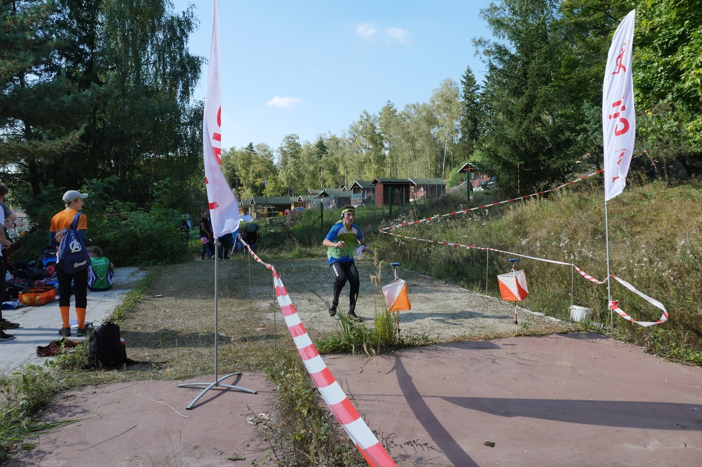
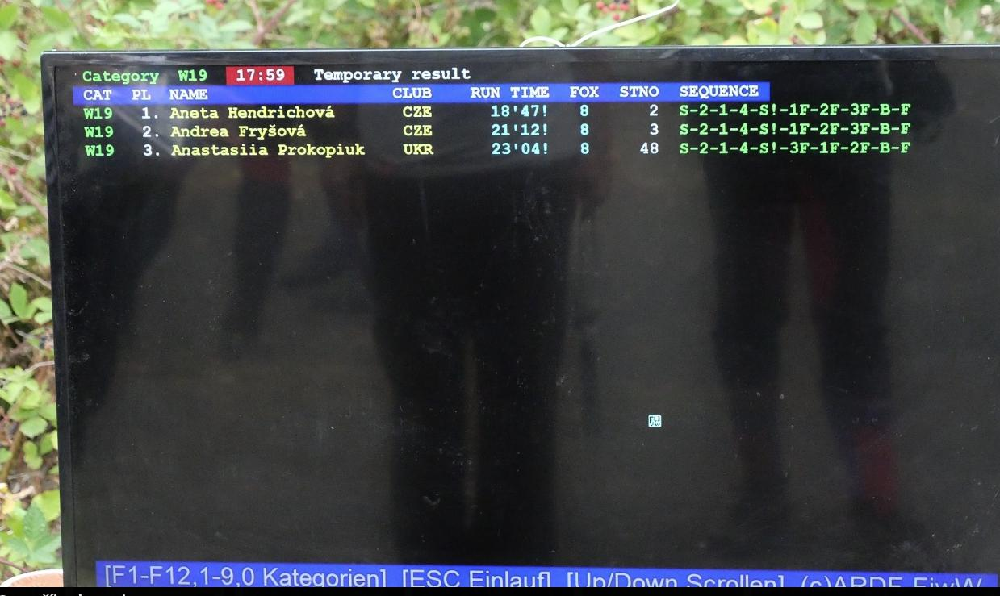

# Cíl
Primárním úkolem cílové skupiny je vyčíst data od závodníků a poskytnout jim občerstvení. V cíli by také měly být k dispozici průběžné výsledky ze závodu a převezené věci závodníků ze startu (pokud nejsou převáženy do centra soutěže).

Pokud je využita cílová karanténa, měl by prostor cíle být jasně vymezen a čas jejího opuštění stanoven v pokynech soutěže. 

## Koncepce cíle
Cílová aréna by měla obsahovat:
- Cílový koridor s cílovou čárou
- Vyčítání výsledků
- Občerstvení
- Věci ze startu
- Prostor pro výklus
- Mobilní WC (volitelné)

## Cílový koridor a cílová čára
Cílový koridor musí být dle pravidel alespoň 3 metry široký a za cílovou čárou musí být poskytnutý dostatečný prostor pro zabrždění. O umístění a druhu koridoru rozhoduje stavitel trati, avšak obvykle ho staví pořadatelé v cíli, proto je potřeba předat informace správně.

Na cílové čáře by měly být umístěné alespoň dvě cílové SI jednotky, opět časově seřízené. Cílový rozhodčí by se měl nacházet v blízkosti cílové čáry, aby závodníkům bylo umožněno podat protest proti situaci, která nastala na trati -- v takové situaci totiž závodník nesmí komunikovat s ostatními závodníky před jeho podáním (viz Pravidla ROB, článek 10.2)

*Oboustranně souvislý cílový koridor s jasně označenou cílovou čárou a dvěma SI jednotkami.*

## Vyčítání a průběžné výsledky
Vyčítání se umisťuje do bezprostřední blízkosti cílové čáry tak, aby závodníci prakticky museli projít okolo a nemohli zapomenout si vyčíst čip. Při organizaci vyčítání je potřeba nezapomenout dostatečnou zásobu termopapíru pro tisk mezičasů a také zdroj energie pro vyčítací počítač (powerbanka / elektrocentrála).

Průběžné výsledky lze zveřejňovat několika způsoby:
- papírově (špagátostrojem)
- na obrazovkách
- elektronicky na internetu (přes ROBis)

Ideální je výsledky zveřejňovat kombinací těchto metod, aby i závodníci bez přístupu k internetu mohli vidět průběžné pořadí. Bývá zvykem v blízkosti výsledků umístit mapu s vzorovými lokacemi kontrol.

*Průběžné výsledky zveřejněné na obrazovce. Oproti papíru se však špatně porovnávají mezičasy.*

## Občerstvení
Závodníkům by měla být v každém případě po doběhu k dispozici voda v dostatečném množství. Je možné přidat další občerstvení (štávu, sušenku, ovoce atd.) podle možností pořadatele. Množství vody je potřeba odhadnout podle počtu závodníků, vliv má zejména teplota a náročnost trati. V letních měsících je lepší mít vždy rezervu, případně upozornit závodníky, aby si vzali do cíle také vlastní pití. Stejně tak se dá snížit plastový odpad doporučením vlastních kelímků ve věcech na cíl. Oboje však musí být předem uvedeno v pokynech.