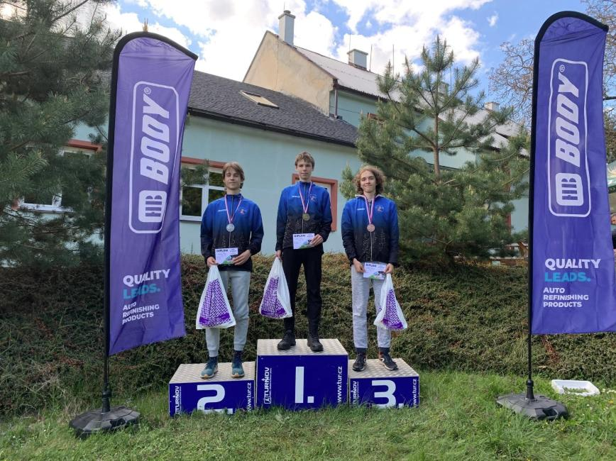

# Po skončení
Po skončení samotného závodu je potřeba transportovat materiál a obsluhy z lesa, provést vyhlášení výsledků a připravit materiál na další závod, či případně vše zabalit. Kontrolu je vhodné provést co nejdříve, protože pak už bývá na hledání pozdě.

Z lesa by měly zmizet veškeré známky po soutěži -- značení, kontroly, odpadky atd. V ideálním případě by nemělo být poznat, že se v lese cokoliv odehrálo -- lesní správci toto oceňují a bývá pak jednodušší se do daného prostoru vrátit.

## Kontrola materiálu
Kontroly od obsluh by se měly vybrat, vyndat na hromádky, a zkontrolovat zda něco nechybí (např. prvky, uzemnění, házedlo atd.). Vysílače by se měly dát nabít a před dalším závodem opět naprogramovat a sesynchronizovat. 

Pokud se jedná o poslední závod, je na místě materiál opět zabalit a připravit k další přepravě. Pokud při závodě pršelo, je potřeba vše mokré vysušit, aby při dalším skladování nedošlo k degradaci kvůli plísni či korozi. Důkladnou péčí se životnost plachet a stanů dá výrazně prodloužit, vhodné je také jednou za čas plachty impregnovat.

## Finální výsledky a vyhlášení
Finální výsledky je vhodné do ROBisu nahrát hned po uplynutí lhůty na podání protestů. Stejně tak by měly být zveřejněné v papírové podobě v centru soutěže. Pokud analýza na OriPlay nebyla dopředu připravena, měl by pořadatel nahrát mapy a výsledky i tam.

Vyhlášení se provádí na dostatečně důstojném místě ideálně s jednolitým pozadím, za použití stupňů vítězů. Nejsou-li ty k dispozici, lze využít improvizované stupňě za pomocí lampionů a čísel, či menší stupínky. Obzvlášť na soutěžích I. stupně lze předpokládat další využití fotek a ty by tak měly být dostatečně reprezentativní.

