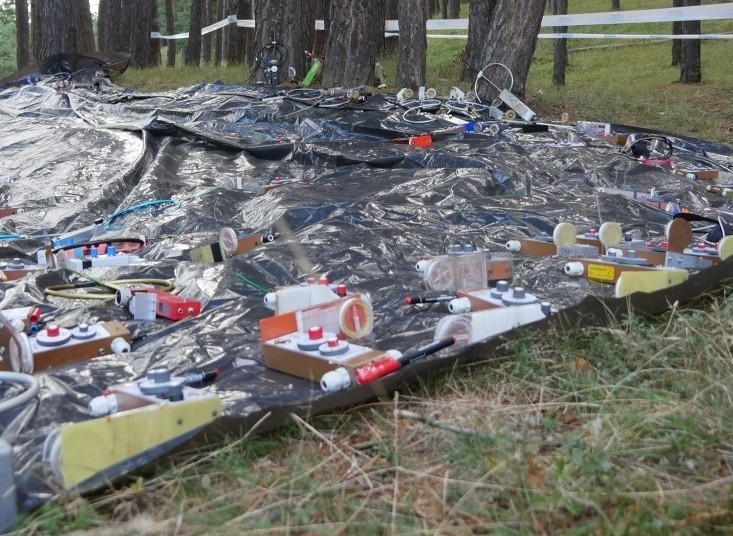
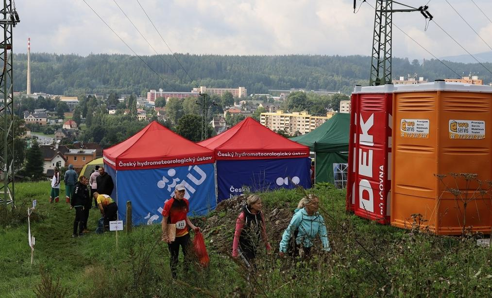
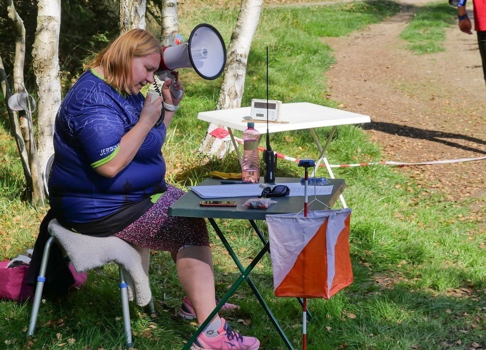
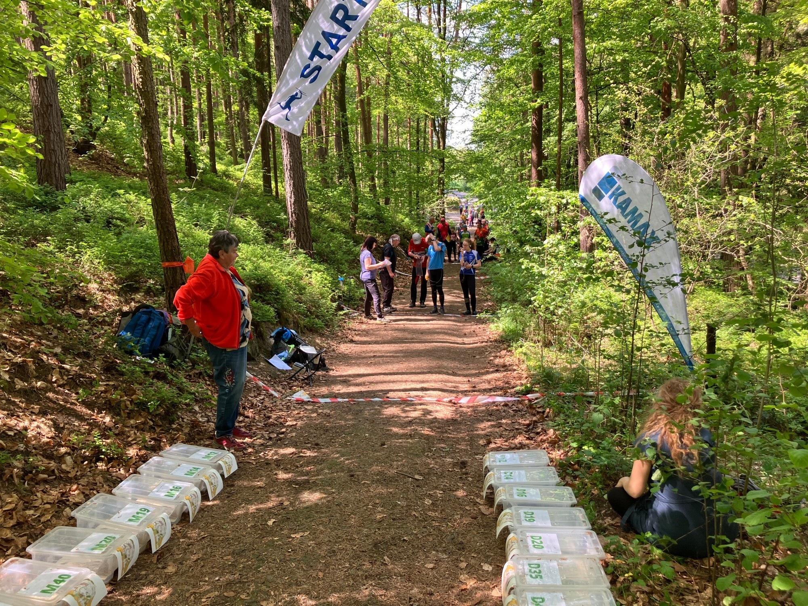

# Start

Správně zorganizovaný start dokáže ušetřit značné množství problémů a závodníkům přináší lepší dojem ze soutěže jako takové. Na startu není potřeba velké množství pořadatelů, minimálně však tři (vyvolávání, předávání map a startér). Start by měl být spojen s cílem ideálně přes pojítko, případně přes telefonní síť pro předávání aktuálních informací (změny čipu atd.). Pokud nelze start propojit přímo, komunikuje se přes dispečink.

## Koncepce startu
Start by měl obsahovat:
- Prostor na odevzdání přijímačů
- Prostor pro čekání závodníků + místo pro rozcvičení
- Prostor na odevzdání věcí do cíle
- Prostor pro vyvolávání závodníků
- Prostor pro úpravu mapy
- Startovní čáru a koridory
- Mobilní WC (volitelné)

### Odevzdávka přijímačů
Přijímače by měly být odevzdávány s dostatečným předstihem tak, aby mohla být otestována funkčnost všech vysílačů, včetně záložních. Pro uskladnění přijímačů je ideální velké rovné místo v blízkosti úpravy map. Přijímače by měly být chráněny před deštěm a před přímým slunečním zářením (obvzlášť v letních měsících). Pro tyto účely je ideální použít buď stan, či nepromokavé plachty, umístěné ve stínu.

*Příklad odevzdávky rádií. V případě deště je nutné mít k dispozici další plachtu pro zakrytí.*

### Prostor pro závodníky
Po odevzdávce rádií a mezi samotným startem závodníci obvykle čekají poměrně dlouhou dobu. Kromě adekvátního prostoru by měli v místě čekání mít k dispozici vytištěnou startovní listinu a pokyny. Pokud předpověď téměř jistě nevylučuje déšť, je nutné počítat i s mokrou variantou a poskytnout pak všem závodníkům adekvátní přístřeší (například v podobě stanů).

Je-li startovní pole delší a hrozí riziko předání informací, pak by čekající neměli mít mobilní telefony na startu pod hrozbou diskvalifikace. Dnes je však trendem sledovat průběžné výsledky online a důvěřuje se tak závodníkům, že telefony nebudou používat k podvodům. V takovém případě by je měli mít vypnuté a schované ve věcech na cíl. 

*Příklad prostoru pro závodníky na MS 2023. Počet stanů musí být adekvátní počtu účastníků.*

### Vyvolávání závodníků
Vyvolávání závodníků by mělo být umístěno na kraji předstartovní přípravy v dostatečné vzdálenosti od sezení závodníků, aby hlášení mohli všichni slyšet. Stejně tak by nemělo být možné projít do předstartovní přípravy jinudy než kolem vyvolávacího místa. U vyvolávání mají být umístěny jednotky pro mazání a kontrolu čipů, pokud je použito bezkontaktní ražení, tak i jednotka SIAC test. 

Do přípravy by se mělo volat s dostatečným předstihem -- závodník má právo vidět mapu alespoň 10 minut předem na klasikách, při sprintu a krátkých tratích nejméně 5 minut. Pokud je nutné popojít po kontrole čipů nějakou vzdálenost, je lepší použít delší interval.

K samotné kontrole čísel čipů lze použít papírové startovky po minutách, či případně aplikaci O-Checklist, která po nahrání startovky umožňuje automatickou kontrolu čísel čipů. Pokud je na startu signál, O-Checklist lze zároveň přímo spojit přes s ROBis s vyčítáním v cíli a odpadá tak nutnost manuální úpravy čísel čipů. Více detailů je dostupné v [nápovědě ROBisu](https://rob-is.cz/napoveda#other-ochecklist).

*Příklad vyvolávání závodníků včetně SI jednotek pro mazání a kontrolu čipů.*

### Úprava map

Pokud závodník dostává mapu před startem, měl by mít k dispozici adekvátní prostor pro její úpravu do mapníku. Mapy by měly být umístěny tak, aby na ně ostatní závodníci odevzdávající rádia či čekající na svůj start nemohli vidět. Ideální je úpravu map umístit do stanů na dostatečné množství stolečků. K dispozici by měla být vždy izolepa a permanentní fixa, vhodné jsou i nůžky a pytel pro případné papírové odstřižky. Na všech vzorových mapách musí být zakresleny stejné lokace (start, cíl, maják, koridory atd.) včetně zakázaných prostorů. Kromě toho by na stolku měly být umístěny pokyny včetně vyhledávaných vysílačů, jelikož závodníci často zmatkují a chtějí si vyhledávky zkontrolovat.

### Startovní čára a koridory
Startovní čára a startovní koridory musí být jasně označené. Konce koridorů se nejlépe značí cedulí "Konec koridoru", startovní čára buď pomocí transparentu, či případně nataženého fáborku na zemi. Pokud se startuje na startovní krabičku, měl by mít každý startovní koridor svojí (se správně seřízeným časem). Startér by měl závodníky v dostatečných intervalech upozorňovat na okamžik startu (tj. například "půl minuty, deset sekund, 3, 2, 1, START").

#### Startovní hodiny
Startovní hodiny lze použít buď specializované elektronické, nebo v podobě aplikace (například [Go start](https://play.google.com/store/apps/details?id=se.tg3.startclock)). Elektronické hodiny i startovní tablet / telefon je potřeba před soutěží nabít a zkontrolovat synchronizaci času. Stejně tak je potřeba správně nakonfigurovat intervaly a zkontrolovat, zda je hlasitost adekvátní. V případě použití aplikace se doporučuje telefon připojit na powerbanku, aby vydržela baterie.

#### Výdejna map
Při závodě na foxoringu obdrží závodník svoji mapu v moment startu. To je nejlepší provést obdobně jako na klasickém OB za pomocí bedýnek s mapami za startovní čárou. Bedýnky by měly být uspořádány v logickém chronologickém pořadí podle kategorií a každá bedýnka by měla být jasně označena. 

*Příklad výdejny map za startovní čárou. Bedýnky jsou jasně označené a mapy povytažené pro rychlý odběr.*