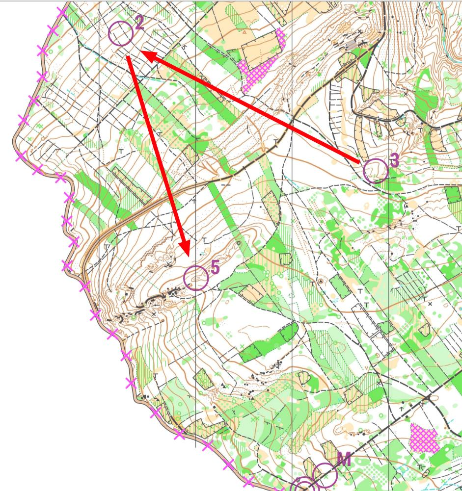
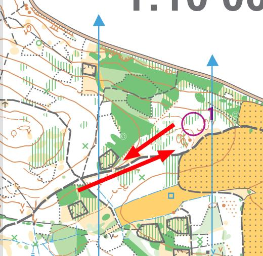
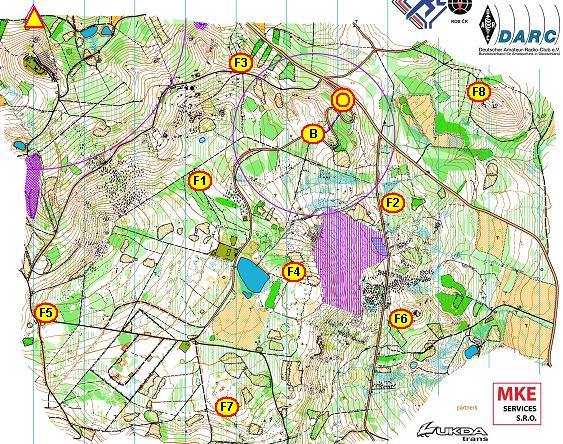
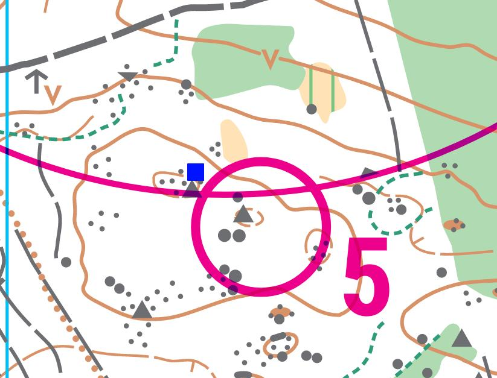
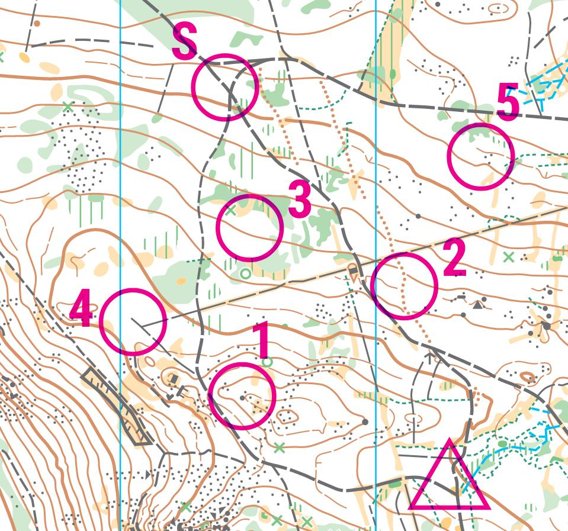
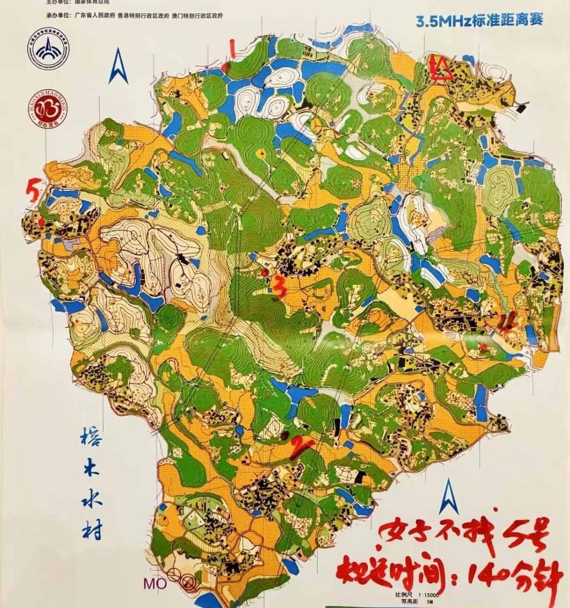

# Časté chyby při stavbě tratí

## Protiběh

Jako protiběh se označuje situace, kdy se závodníci na trati potkávají v opačném směru. Typicky se tak stává po oražení kontroly, která je umístěna v příliš ostrém úhlu s následující kontrolou a závodník se tak v podstatě vrací zpátky po směru předchozího postupu. 

*Protiběh způsobený ostrým úhlem mezi kontrolami. Řešením je posunutí kontroly číslo 3 více na sever, či přemístění kontroly číslo 2 více na jihozápad.*

K protiběhu může docházet i při existenci výrazných překážek na přímém postupu k další kontrole (hustník, údolí), které nutí závodníka vrátit se stejným způsobem zpět.

*Protiběh kvůli terénní překážce -- závodníci při postupu na západ budou volit raději cestu, než hustník.*

Protiběh bývá obvykle nežádoucí, protože prozrazuje pozici kontroly a dává závodníkům informace o jejich soupeřích. Obvykle se mu dá vyhnout zmenšením úhlu mezi kontrolami, případně přesunutím kontroly mimo oblast s výraznými překážkami.

## Schované kontroly
Pokud se nejedná o foxoring, měla by kontrola být viditelná ze všech možných náběhových směrů. Častou chybou stavitele je umístění kontroly na místo, odkud ji nelze mimo relaci dohledat (hluboká jáma, hustník atd.). V momentě, kdy závodník na takovou kontrolu nabíhá mimo relaci, téměř nemá šanci ji bez jiných závodníků najít, což do závodu přináší zbytečný element náhody a pocit frustrace. Samotná obsluha by si po postavení kontroly měla zkontrolovat, zda je lampion dostatečně viditelný.

<!-- TODO: doplnit obrázek schované kontroly -->

## Postupy přes cíl a nevhodné umístění majáku
Nemělo by se stát, že ideální postup mezi kontrolami vede přes cíl či přes maják. Dle pravidel ROB je pro závodníka povoleno cílovou arénou proběhnout a stavitel tak riskuje srážky závodníků na trati s doběhlými závodníky a podobné zmatky. V cíli často také bývá vyvěšená mapa s zákresem vzorových kontrol a ačkoliv by za nahlédnutí do mapy byla jistá diskvalifikace, je lepší těmto situacím předcházet.

Obdobným problémem je vedení doběhu na maják přes cílovou čáru či v její blízkosti. Opět přichází v potaz riziko srážky a navíc pokud je použitý oboustranný souvislý koridor, vede toto k zbytečné diskvalifikaci zejména nezkušených závodníků. Opět se této situaci dá předejít důslednou kontrolou možností doběhu do cíle a případným posunutím majáku.

*Ukázka nevhodné stavby, kdy postupy z kontroly F3 na F2, F6 i F8 vedou přes cíl. Zároveň je maják umístěn tak, že závodníky dobíhající z F8 velmi navádí k opačnému proběhnutí cílového koridoru. Stačilo cíl posunout o křižovatku severněji a oba problémy by byly vyřešené.*

## Nedodržení minimálních vzdáleností

Při dnešním použití programů pro stavbu tratí obvykle nebývá problém vzdálenosti mezi kontrolami změřit. Problém nastává při samotném roznosu, kdy obsluha nenajde při stavbě vhodné místo a kontrolu tak nechtěně posune pod minimální vzdálenost. Této chybě se dá vyhnout kontrolou místa před samotným závodem (ideálně s následným štítkováním) a důslednou instruktáží obsluhy. Té je potřeba do mapy případně vyznačit kontroly, u kterých hrozí porušení minimální vzdálenosti, aby věděla, jakým směrem může kontrolu posunout.

Pravidla ROB definují minimální vzdálenosti následovně[^1]:

| Disciplína | Vzdálenost od startu / koridoru | Vzdálenost od dalších kontrol 
| :--- | :--- | :--- | 
| **Klasická trať, dlouhá trať, noční závod** | 750 m (pro kategorie MD12 a MD14 platí 500 m) | 400 m |  
| **Krátká trať** | 500 m | 400 m |
| **Sprint** | 100 m od konce startovního koridoru (kromě divácké a majáku) | 100 m 
| **Štafety** | 100 m od konce startovního koridoru (kromě divácké, farstovaných a majáku) | 100 m od dalších kontrol téže tratě 
| **Foxoring** | 250 m od startu (s vyjímkou majáku) | 250 m 

*Příklad kontroly nechtěně umístěné do kolečka. Modrý čtvereček značí reálné umístění kontroly.*

*V tomto případě sice nejsou minimální vzdálenosti porušeny, ale při roznosu je velmi jednoduché postavit kontroly blíž sobě, než je plánováno na mapě. Stavitel by měl zvážit navýšení vzdáleností.*

## Kontroly na hraně mapy
Stavbou kontrol na hranu mapy stavitel riskuje riziko vyběhnutí závodníků mimo závodní prostor, stejně tak jako možnou chybu obsluhy při stavbě (pokud není použito štítkování) a umístění kontroly mimo mapu. Pokud na hraně není výrazná zastavovací linie (kraj lesa, silnice, řeka), měl by se stavitel umístění obdobných kontrol vyvarovat.

*Kontrola číslo 1 je v tomto případě umístěna na samotném okraji mapy bez zastavovací linie a je tedy velmi jednoduché z mapy vyběhnout.*

[^1]: [Pravidla ROB](https://ardf.cz/clanek/6/dokumenty-ke-stazeni.html)