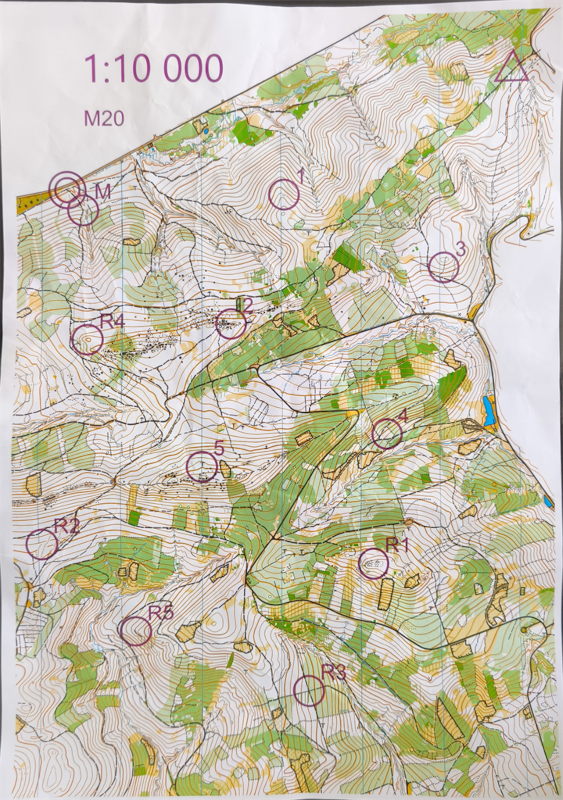
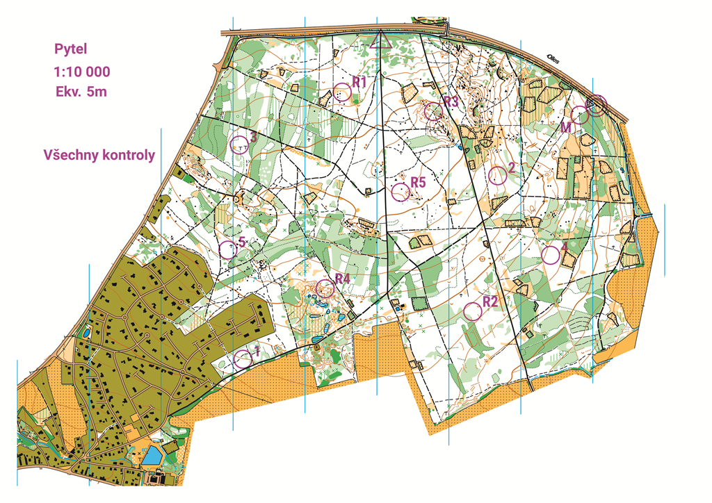
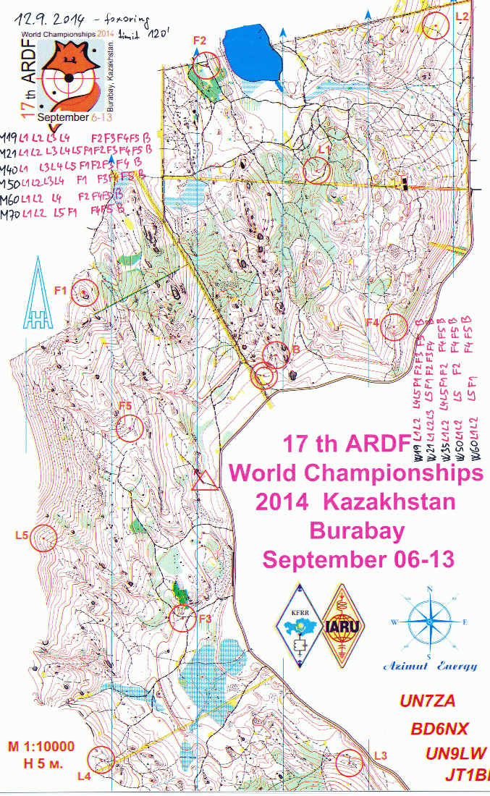

# Stavba foxoringu
Foxoring je disciplínou nejvíc podobnou klasickému orientačnímu běhu -- závodník musí být schopen dobře pracovat s mapou a samotné zaměřování provádí až v bezprostřední blízkosti kontroly. Z toho důvodu by měla správná trať foxoringu být navigačně náročná a správné pořadí by nemělo být jednoznačně dané z prvního pohledu na mapu.

Pro dobrý foxoring je potřeba kvalitní a aktuální mapa -- oproti ostatním disciplínám nestačí pouze hlavní rysy terénu. Z tohoto důvodu se mapy před velkými závody na foxoringu revidují.

## Klíčové prvky foxoringu
- **Nejjednoznačné pořadí** -- pořadí by nemělo být jednoznačné. Toho se dá kromě tvaru trati dosáhnout pomocí umístění kolečka kontroly výš / níž ve svahu, případně za výrazné překážky na postupu atd.
- **Navigačně náročný** -- postupy by měly být ideálně mapově těžké, ne pouze za použití výrazných objektů (cest, oplocenek atd.), případně takové postupy znevýhodnit.
- **Kontrola ve stejné výšce jako kolečko** -- závodníci by při plánování měli cílit na střed kolečka. Samotná kontrola by se tak měla nacházet na stejné vrstevnici jako je střed kolečka, aby nezvýhodňovala náběh zespodu / zeshora.
- **Složitější dohledávky** -- díky permanentně vysílajícím kontrolám je foxoring jedinou disciplínou, kdy si stavitel může dovolit (a dokonce je žádoucí mít) schované kontroly. Kontrolu by však mělo být možné bez problémů naladit, tj. neumisťovat ji na samou hranici slyšitelnosti ze středu kolečka.
- **Adekvátnost pro všechny kategorie** -- u foxoringu je jednoduché postavit jednu či dvě dobré tratě. Ostatní kategorie by však také měly mít hezkou a smyslupnou trať, na což se bohužel občas zapomíná. Pokud je v závodě zařazena velmi fyzicky náročná kontrola (například na vrcholu kopce), měl by stavitel zvážit její vynechání pro dětské a veteránské kategorie.

## Příklady dobře postavených tratí

Tento foxoring byl postaven na nominační soustředění reprezentace 2025 Andrejem Gomzykem. Hned po startu klade pro závodníky volbu, zda začít na kontrole č. 1, či stočit dolů do údolí na kontrolu č. 3. Podle toho se i odvíjí následná volba konce, kdy závodník musí volit postup 5-R4-2-1-M, nebo 5-2-R4-M.

Trať jako taková se nachází ve velmi členitém terénu, kdy je kromě mapové techniky výrazně prověřena fyzická forma. Klíčové volby postupů jsou obíhačky mezi 4-R1 a R1-R3. Kontroly byly často velmi schované v prostorech mimo kolečko a bylo nutné tak důsledně zaměřovat.

Druhou pěknou trať bylo možné vidět na nominačním soustředění veteránů 2026 u Plzně. Opět je nutné hned po startu řešit volbu počáteční kontroly a podle toho rozhodnout, kdy brát středovou kontrolu R5. Všechny kontroly jsou poměrně blízko sebe, tudíž je nutné neustále nutné ladit a přemýšlet nad postupy. Ačkoliv trať nabízí i pár postupů čiště po cestě, je i tak nutné zvolit správnou z nich a neudělat tak paralelní chybu.

## Příklad hůře postavené tratě
Za ukázku špatné tratě může posloužit foxoring z MS 2014 v Kazachstánu. Tři kolečka umístěné na kraji mapy, z čehož dvě kontroly byly reálně mimo mapu. Při postupu L4-L5 při snaze zachovat výšku závodníci opět riskují výběh z mapy.

Startovní koridor vede úplně opačným směrem než je ideální počáteční kontrola, což vedlo k otáčení ihned za koridorem. Maják je zbytečně vysunutý a kvůli použití oboustranného koridoru zde došlo ke zbytečným diskvalifikacím. Trať jako taková prakticky nenabízí volbu pořadí, a až na pár postupů není technicky náročná, což je v tomto pěkném terénu škoda. 

Pro starší veterány je kontrola L5 zbytečně náročná -- spousta z nich se ze závodu vracela bez kontrol. Detailní výsledky lze najít [zde](https://ardf.darc.de/contest/14090812/14090812.htm).

