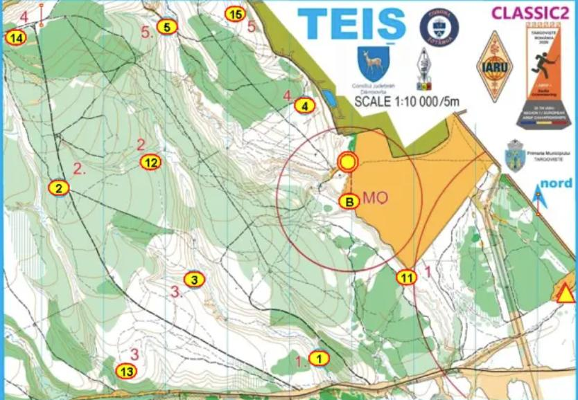
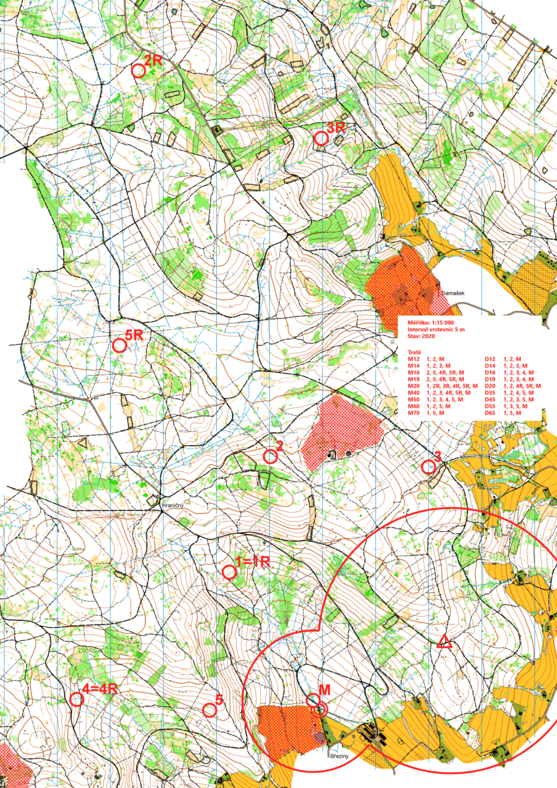
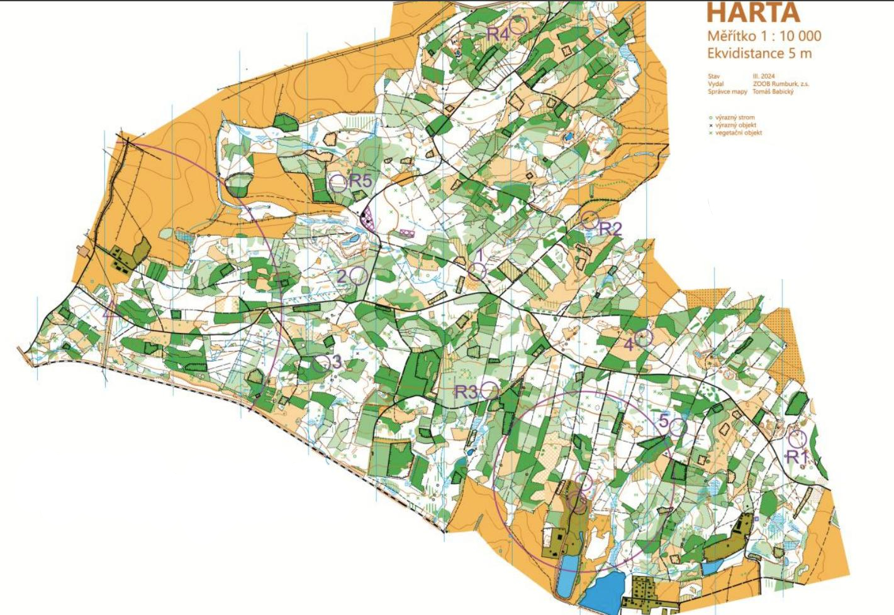

# Stavba klasických tratí

Klasická trať je disciplínou charakteristickou pětiminutovou relací a směrným časem okolo hodiny. Závodníci na trati musí umět dobře hospodařit s energiií, aby byli schopni zrychlovat v klíčových pasážích. Ačkoliv i na světové scéně jsou k vidění tratě na 40 a méně minut, nejedná se o trend hodný následování, jelikož poté klasika ztrácí svůj charakter a přibližuje se spíše krátké trati. 

Pro klasickou trať je potřeba poměrně velký závodní prostor, obvzláště pokud se jedná o rovinatý terén. Startovní kolečko o velikosti 750 m samo o sobě ukousne pořádnou část mapy, obzvlášť když start z nějakého důvodu nemůže být umístěn na kraji.

U klasik platí dvojnásob, že by trať neměla být předvídatelná hned z umístění startu a cíle -- pokud se například nabízí náběhovou kontrolu umístit na kopec hned za kolečkem, je dobré zvážit jiné umístění. U dvoumetrů by se neměly "vymetat" nejvyšší vrcholy na mapě atd.

## Klíčové prvky stavby
- **Variace mezi postupy - krátký / dlouhý** -- klasická trať by měla nabídnout různé délky mezi kontrolami -- např. krátký náběh na kontrolu hned za kolečkem, pak dlouhý postup na druhou kontrolu, třetí opět kratší atd. Tím závodníka stavitel nutí důsledně přemýšlet a průběžně měnit tempo i taktiku.
- **Variace pořadí kontrol** -- pořadí kontrol by nemělo být ihned ze začátku jasné, avšak mělo by být určitelné. Závodníci pracující s mapou a kreslící jasné zákresy by měli mít výhodu oproti těm, kteří běží pouze za signálem.
- **Běh na azimut** -- některé postupy lze cíleně stavět s tím, že doběh na kontrolu vychází mimo relaci. Pro závodníky se tak jedná o další technický prvek, který musí zvládnout.
- **Viditelně umístěné kontroly** -- klasické tratě by neměly obsahovat složité dohledávky se schovanými kontrolami, protože pak dochází ke sdružování závodníků na kontrolách a ztrátu pěti (a více) minut je extrémně těžké dohnat.
- **Pásmo** -- při dvoumetru lze pracovat s obtížností zaměření kontroly díky jejímu umístění. Kontrola za hranou svahu bude velmi slabá do momentu naběhnutí nad ní, naopak kontrola na náběžné straně vysokého kopce bude velmi hlasitá i z větší vzdálenosti. Všechny tyto prvky by však měly být aplikovány s mírou, tj. neumisťovat dvoumetrovou kontrolu do rokle či osmdesátkovou za oplocenku atd.

## Použití rychlých kontrol
Díky rychlým kontrolám lze lépe stavět větší množství tratí, na druhou stranu větší množství kontrol klade zvýšené nároky na množství pořadatelů, aut a materiálu. Optimální počet kontrol celkem by tak měl být kolem 6 až 9 kontrol.

Aby se závodníkům ušetřilo přelaďování, je možné některé rychlé kontroly spojit s pomalými pomocí umístění na stejné místo. V takovém případě musí být dle pravidel číslo kontroly shodné (tj např. 2/R2), SI jednotka označená oběma kódy a vysílače musí být umístěny minimálně 6 metrů od sebe (viz článek 17.3).

## Práce s kolečky
Prostor vynechaný kolečkem od startu a cíle není vždy úplně ztracený -- z pohledu stavitele se s ním dá velmi dobře pracovat. Například je možné start / cíl umístit tak, aby kolečko zabralo neprůstupnou část lesa (hustníky, kopce), či umístit kontrolu mezi kolečka. Stejně tak lze naopak závodníky nalákat k domněnce, že se kontrola nachází mezi kolečky a tak je donutit k horšímu postupu od startu. Stále je však nutné pamatovat na principy dobrých tratí a vyhnout se protiběhu.

*Příklad kontroly umístěné mezi kolečky. Závodníci už od startu tak musí volit, zda naběhnout k cíli, či nikoliv.*

## Příklad dobře postavené tratě
Následující trať je z NŽ 2021 ve Svratouchu, pásmo 3,5 MHz, stavitel Petr Matula. Použity byly všechny rychlé kontroly, pouze tři z toho samostatně. Závodníci tak nemuseli tolik přelaďovat mezi frekvencemi. Pro veteránské kategorie byla mapa k dispozici v měřítku 1:10000 a formátu A3.

Náběhové koriodry dostatečně rozdělují závodníky mezi kontrolami 2 a 3. Trať nabízí variabilitu pořadí pro delší kategorie, zejména u elity je nutné řešit volbu mezi trojúhelníkem 1--4R--5R. Tratě mladších závodníků jsou vedeny v relativní blízkosti cíle s kontrolami u velkých cest, tj. i relativně svážný postup z kontroly č. 1 není nebezpečný.

Kontroly jsou postavené v dobře prostupném lese, tj. dohledávky nejsou náhodné, úhly mezi kontrolami nevedou k výrazným protiběhům. Doběh do cíle vede od majáku po velké zpevněné cestě.

## Příklad hůře postavené tratě
Tato trať splňuje všechny náležitosti dle pravidel ROB, avšak bohužel ztrácí kvůli chybám na kvalitě. Samotný terén obsahuje pro ROB velké množství hustníků, které výrazně komplikují průběžnost terénu a tak není možné využít běh na azimut -- většinu postupů se vyplatí obíhat po cestách. Kontroly jsou často umístěné ve uzavřeném terénu -- např. kontroly číslo 3 a R3 na hraně hustníku opět velmi ztěžují případnou dohledávku. Kontrola R2 je umístěna na kraji mapy bez výrazné zastavovací linie.

Na startu byl použitý pouze jeden startovní koridor, což při větším počtu závodníků vede ke společným postupům na náběhové kontroly.

Umístění R4 navádí k protiběhu -- závodník odbíhající z R4 optimálním směrem na R2 se bude s velkou pravděpodobností potkávat s dalšími závodniky. Obdobné riziko je i u R1, kdy však záleží na volbě postupů na maják. Ten je vysunut poměrně vysoko a zabírá tak velkou část průběžného lesa (zde samozřejmě záleží, zda šel cíl postavit jinde).

