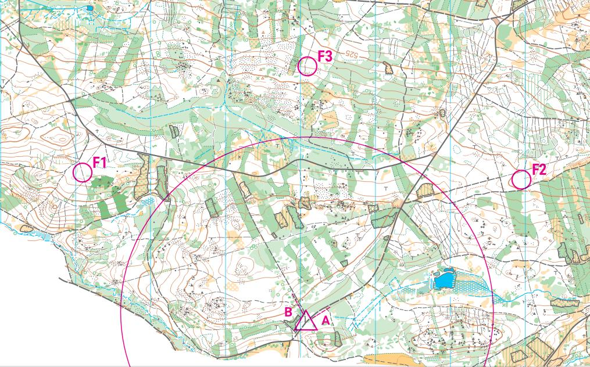
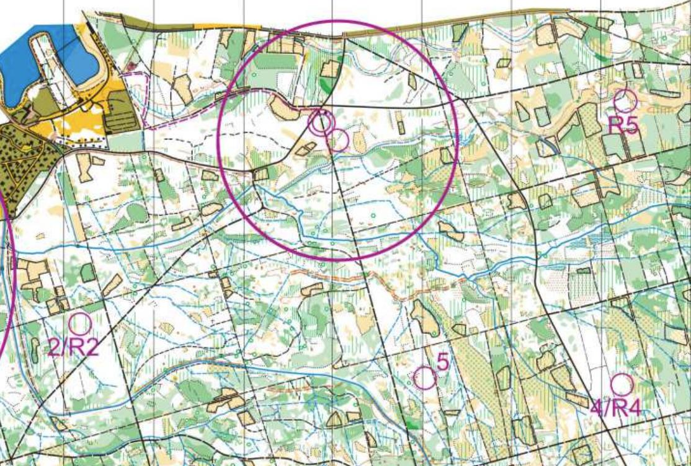
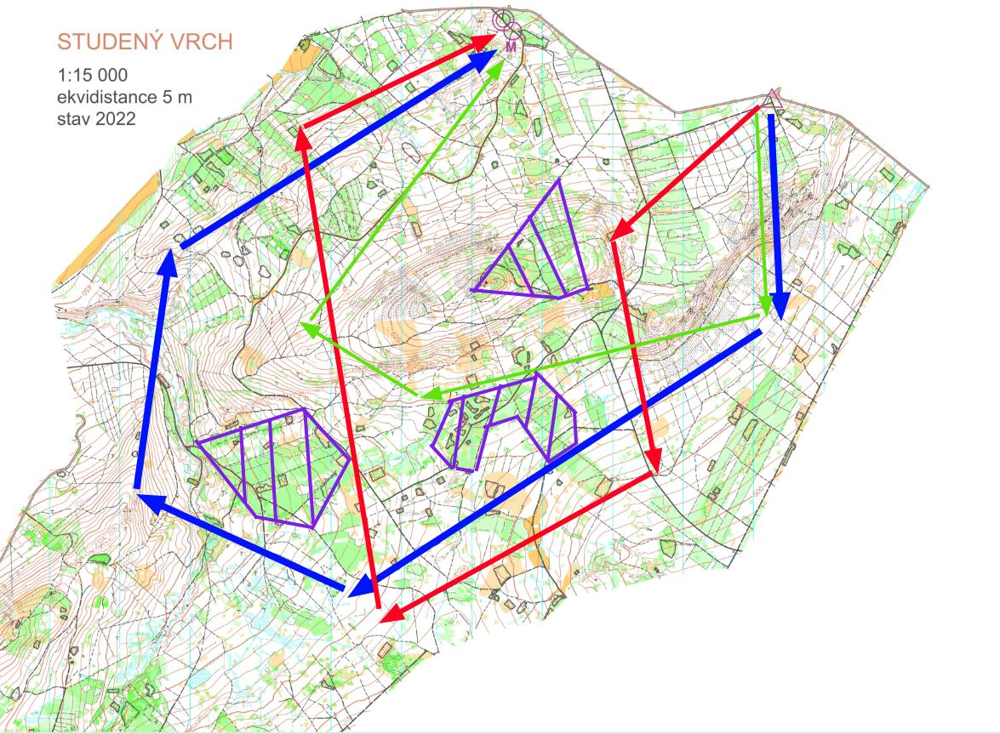
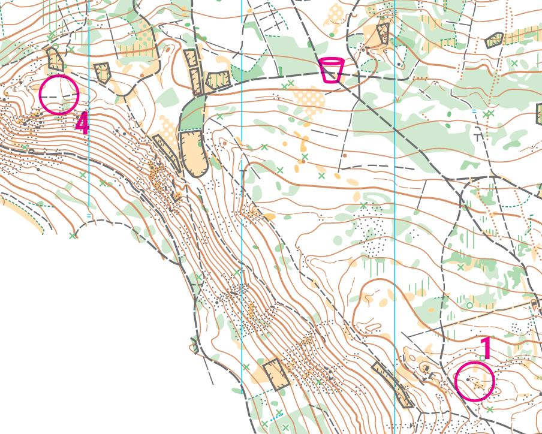

# Koncepce trati

## Postup stavby tratí
1. **Volba umístění startu a cíle** -- stavitel při tomto spolupracuje s ředitelem soutěže a ostatními činovníky, aby lokace splňovaly požadavky na dopravu, parkování atd.
2. **Výběr počáteční tratě pro stavbu** -- tratě se obvykle staví buď od nejtěžší kategorie (typicky M20), či od nejlehčí kategorie (D12/D65). Detaily níže.
3. **Stavba ostatních tratí** -- ostatní tratě jsou tvořeny vynecháváním některých z kontrol. Vždy je nutné zkontrolovat, že směrné časy a počty kontrol odpovídají pravidlům.
4. **Testování tratí** -- u menších soutěží tento bod bývá často vynechán, nicméně u vyšší soutěže je dobré, aby trať někdo zkusmo proběhl. Pokud je mapa staršího data, dá se toto spojit s revizí prostoru. 

## Umístění startu
Start by měl být umístěn tak, aby byl dobrým výchozím bodem pro samotný závod. Měl by poskytnout dostatečné množství startovních koridorů, vhodný prostor pro umístění stanů a v neposlední řadě místo pro rozcvičení závodníků. Kromě toho je potřeba se na start či do jeho blízkosti dostat autem kvůli dopravě materiálu a pro závodníky by neměl být vzdálen víc než cca 2 km od místa parkování.

V závodě na dvoumetru je většinou snaha umístit start na vyvýšené místo a usnadnit tak závodníkům zaměřování. Start umístěný pod kopcem však může být záměr stavitele, je pak však nutné pamatovat na zvýšenou náročnost takovéto trati, zejména pro dětské kategorie.

Koncepce samotného startovního prostoru je blíže popsána v sekci [Start](./../realizace/realizace_start.md) u realizace závodu. Pro stavitele je důležité uvažovat nad lokací startovního koridoru, jelikož v ideálním případě by závodníci čekající na svůj start neměli být schopni vidět odbíhající závodníky. 

### Startovní koridory
Startovní koridor by měl navádět závodníka z místa startu na první kontrolu / do závodního prostoru. Samozřejmě lze volit koridor i jiným směrem, nicméně je nutné předpokládat, že zkušený závodník při takové stavbě bude ihned po konci koridoru zatáčet zpět. Dle pravidel má závodník koridor povinnost dodržet, nicméně na jeho konci pro něj start přestává existovat a nic (pokud není upřesněno v pokynech) mu tak nebrání například proběhnout zpět přes start do druhého koridoru. Takové situaci by se stavitel měl spíš vyhnout, protože přináší zbytečný zmatek do startovního prostoru.

Protože se ve startovním koridoru závodník nesmí zastavit, tak vhodný koridor pro všechny kategorie by němel být delší než 200 m. Konec koridoru musí být zřetelně označen, ideálně cedulí "Konec koridoru".

*Příklad umístění startu s dvěma startovními koridory a počátečními kontrolami. V tomto případě nemají závodníci důvod běhat zpět do druhého koridoru.*

## Umístění cíle a majáku
Cíl většinou bývá vybraný už při samotné volbě závodního prostoru s ohledem na dopravu věcí, stavbu stanů, parkování aut atd. Pro stavitele by měl maják a cíl být umístěn tak, aby poskytoval smysluplné doběhy ze všech předpokládaných koncových kontrol bez průběhu okolo cílové arény (viz [Časté chyby při stavbě](./stavba_chyby.md#postupy-přes-cíl-a-nevhodné-umístění-majáku)). 
Při závodě na dvoumetru by se stavitel měl opět snažit maják umístit na vyvýšené místo, aby tak usnadnil jeho zaměření i z větší dálky.

Cílový koridor musí být dle pravidel alespoň 3 metry široký a za cílovou čárou musí být poskytnutý dostatečný prostor pro zabrždění. Neměl by obsahovat výrazné překážky (jámy, kameny, potoky), jelikož se závodníci většinou soustředí na nejrychlejší běh do cíle a v podobném terénu riskujeme zranění.

Pokud je cílový doběh výrazně z kopce a existuje možnost náběhu na maják ze strany od cíle, měl by stavitel použití oboustranně souvislého cílového koridoru, aby zabránil možným střetům mezi závodníky.

*Příklad lehce neštastně umístěného majáku -- ideální doběh z kontrol 2/R2 a R5 vede téměř podél cíle, což méně zkušené závodníky může vést ke špatnému ražení.*

## Stavba počáteční trati
V ROB je oproti klasickému OB stavitel výrazně omezen počtem kontrol. Ačkoliv teoreticky jich může postavit na klasické trati až 10 + maják, obvyklý počet bývá max. 8. Stavba trati tak obvykle probíhá od nejdelší trati (typicky M20) a následně se postupně vynechávají, či doplňují kontroly pro ostatní tratě. Je však stále potřeba pamatovat na to, že i ostatní tratě musí mít svou koncepci a logiku, na což se často zapomíná a tak na veterány často zbývají jednoduché či vysloveně odfláknuté tratě.

Druhou možností je naopak stavět tratě od nejjednoduších, tj. MD12 a následně pak trať prodlužovat. Tímto způsobem se obvykle nestane, že trať je příliš dlouhá pro dětské a veteránské kategorie, zato však hrozí riziko poddimezování tratí pro elitní kategorie. Ideálním způsobem je tak zmíněné přístupy kombinovat.

Při prvotním pohledu na mapu po stanovení startů a cílů by stavitel měl zvážit výrazné prvky terénu, zakázané / nevhodné prostory a způsob, kterým chce závodníky vést po závodním prostoru. Až potom je na čase začít postupně umisťovat kontroly na mapu a zvažovat, kudy vedou možné postupy mezi nimi.

*Příklad prvotní koncepce tratí. Fialově jsou znázorněné nevhodné prostory pro kontroly (hustníky, oplocenky), modře a červeně vede variantou varianty elitních tratí, zeleně je znázorněna jednoduchá trať.*

## Umístění občerstvovací stanice
Zřízení občerstvovací stanice je doporučeno při teplotě nad 25 stupňů, či při délce nad 10 km, na dlouhé trati je povinná. Občerstvovačka se dá umístit přímo na kontrolu, či na jiné místo na trati, kde však musí být zřetelně vyznačena v mapě.

Občerstvovačka mimo kontrolu by měla být umístěna tak aby byla dosažitelná bez nutnosti velkých záběhů -- tj. závodník by neměl volit mezi tím, zda se napije, či zda poběží optimální postup. To je v ROB poněkud obtížný úkol (vyjma foxoringu), zejména pokud pozicí občerstvovačky nechceme prozradit pozici kontroly.

Stejně jako v klasickém OB platí, že občerstvovačka se umisťuje před umístěním kontrol a ne až po tom, co jsou tratě hotové. V ROB obvykle není potřeba na občerstvovačku průběžně doplňovat vodu, ale i tak by měla být jednodušše dostupná autem.

*Příklad ne úplně vhodně umístěné občerstvovačky. Závodník musí volit mezi rychlejším postupem na kontrolu zleva, nebo delší obíhačkou s napitím zprava.*

<!-- TODO: přidat testování trati -->