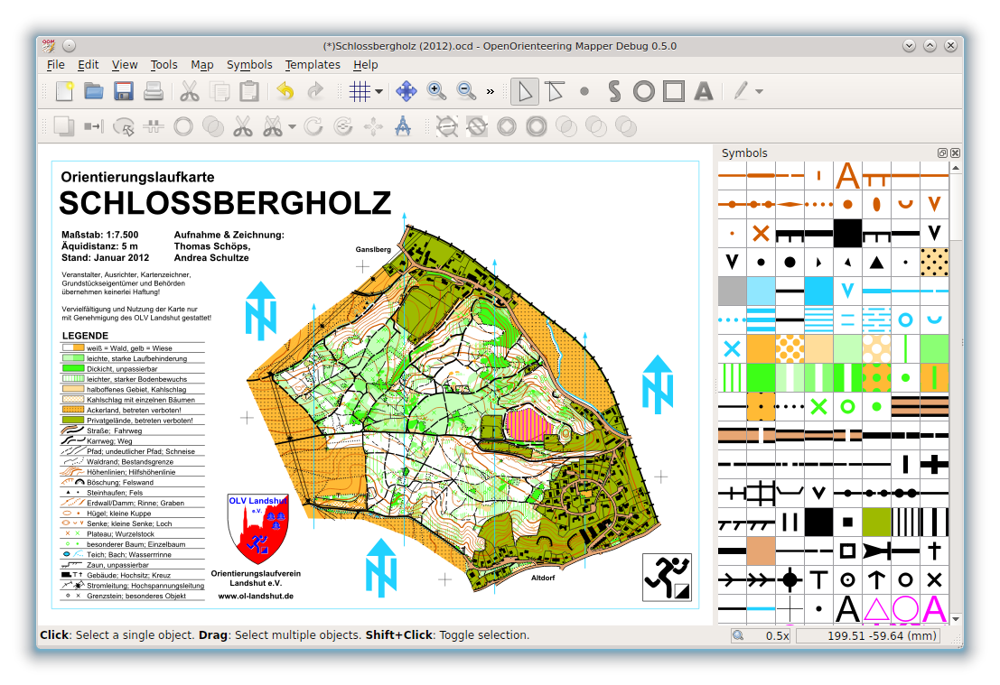
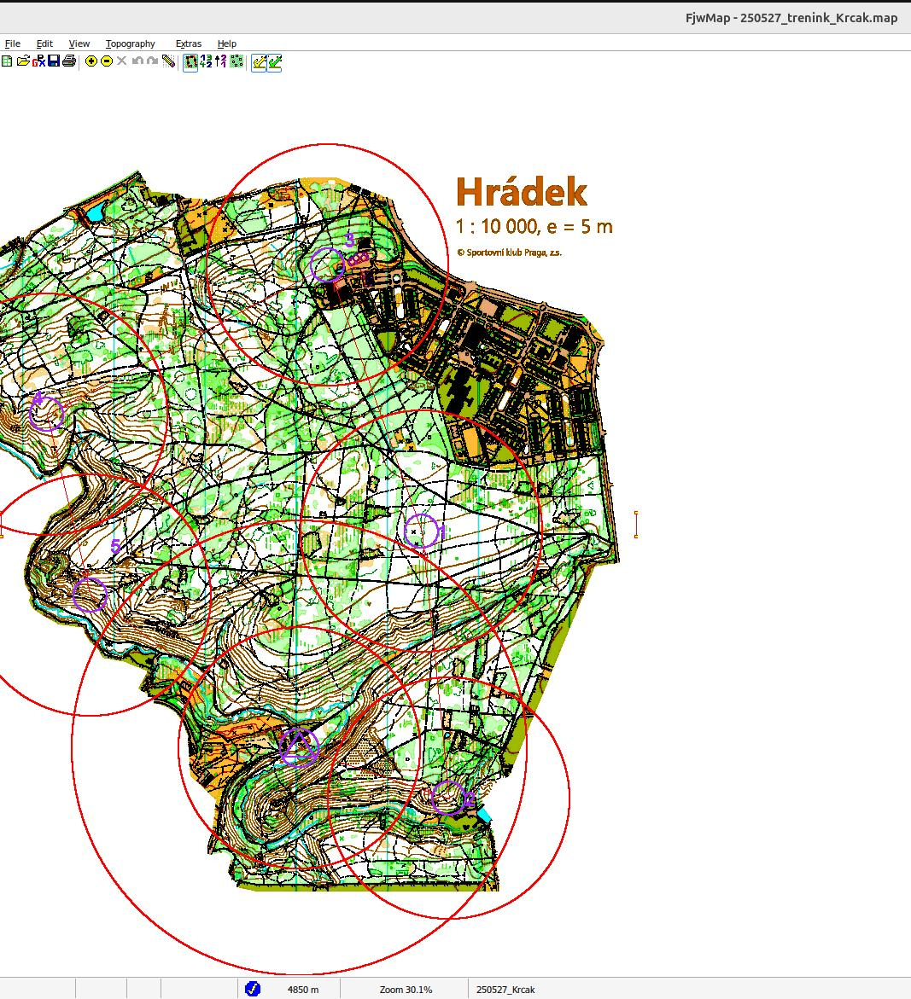
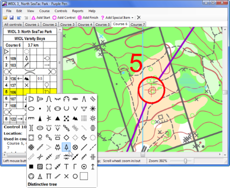

# Nástroje pro stavbu tratí

V dnešní době je stále možné stavět tratě manuálně na papír, nicméně se vyplatí využít speciální programy, které automaticky měří délky tratí, počítají optimální postupy atd. Pro přípravu map na foxoring je použití programu pro stavbu tratí téměř nutností. Většina základních funkcí těchto programů je intuitivní na pochopení a obvykle k nim existuje poměrně velké množství doplňkových materiálů.

## Open orienteering mapper
Open orienteering mapper je program určený pro tvorbu a úpravu map OB. Umožňuje práci s ocd soubory, importování podkladů, používání vlastních mapových značek atd. Zároveň má mobilní verzi pro Android, kterou lze použít pro mapování / revize přímo v terénu.

Základy práce s OO mapperem jsou ukázány ve videu od Karla Vítka [zde](https://www.youtube.com/watch?v=Tbn0K4ObI1Y).

[Stránka projektu](https://www.openorienteering.org/apps/mapper/)

## Fjww Map 
Fjww Map je součást programu pro vyhodnocování závodů ROB od Karla-Heinze Schadeho. Zatímco vyhodnocovací součást programu je placená, součást pro stavbu tratí je zdarma. Program funguje na Windows, pomocí Wine i na Linuxu. Umožňuje import map ve formátu jpg a následnou stavbu kontrol včetně zobrazení minimálních vzdáleností a automatického počítání vzdušné délky trati.

[Stránka projektu](http://www.dl7vdb.de/index_eng)

## Purple pen
Purple pen je program určený pro stavbu tratí v orientačním běhu. Umožňuje import map v mnoha formátech včetně ocd / omap, stavbu tratí včetně tvorby popisů pro orientační běh a hromadné generování výstupních souborů. Funguje jak na Windows, tak na Linux a Mac. Pro ROB je ideální na stavbu foxoringu, jelikož umožňuje vlastní názvy kontrol.

Práci s Purple penem vysvětluje video od Karla Vítka [zde](https://www.youtube.com/watch?v=-CxoIl-VWSo).

[Stránka projektu](https://purple-pen.org/)

