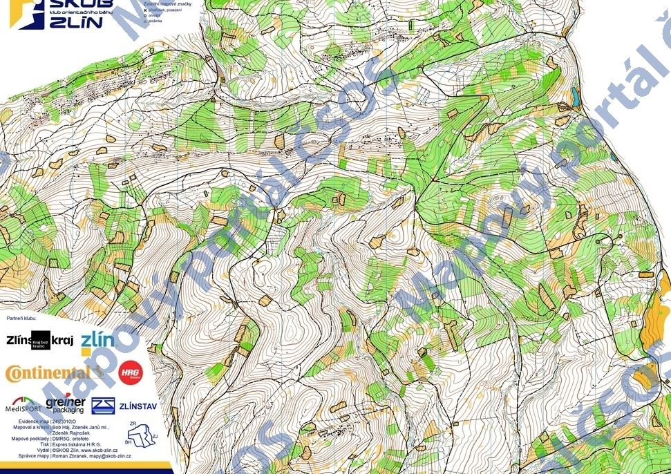

# Principy stavby tratí
Stavba tratí je proces vyžadující kreativitu, znalost pravidel, ale i samotnou závodnickou zkušenost. Kvalitní stavitel trati nemusí být elitní běžec na ME/MS, ale měl by mít odběháno alespoň nějaké množství závodů za rok, aby dokázal své tratě zhodnotit i z opačné strany. Postavit trať na papír je věc jedna, ale druhá věc je být schopen podle reality v terénu trať adekvátně prodloužit/zkrátit, vybrat vhodná místa pro doběhy atd.

Klíčová otázka, kterou by si měl stavitel položit, je stejná jako v klasickém OB: **Máš chuť si svou trať proběhnout?** Pokud ne, tak jsou na místě úpravy.

Pro stavbu tratí na soutěžích ROB je nutné mít maximálně o stupeň nižší třídu rozhodčího, než je stupeň soutěže.[^1] Rozhodčí s třídou R2 tak může stavět tratě i na závodech 1. stupně. Pokud se stavbou tratí daný rozhodčí začíná, o to víc by měl dbát na konzultace s někým zkušenějším (viz sekce [Oponentura](#oponentura)).

## Směrné časy a počty kontrol
Podle pravidel ROB je pro stavitele při stavbě zásadní:
 - U všech kategorií dodržení počtu vyhledávaných kontrol.
 - U kategorií D12, D14, M12 a M14 dodržení délek tratí.
 - U všech ostatních kategorií dodržení směrných časů.

*Efektivním (směrným) časem se rozumí průměrný čas dosažený prvními třemi závodníky v kategorii, případně, nemají-li všichni tři plný počet kontrol, průměr prvních dvou nebo čas vítěze. Efektivní časy vítězů uvedené v pravidlech jsou pro stavitele závazné, a to s tolerancí +20 % až −20 %, v případě pásma 144 MHz zvětšené o dalších 10 %.*[^1]

Samotná tabulka směrných časů je k dispozici v pravidlech a liší se dle konkrétní disciplíny a kategorie. U M20 jsou časy dané takto: 
- klasická trať: 65 min
- krátká trať: 35 min
- dlouhá trať: 130 min
- sprint: 15 min
- foxoring: 40 min
- noční: 50 min
- štafety: 20 min / úsek

Postavit trať tak, aby splňovala směrné časy ve všech kategoriích je poměrně náročný úkol, nehledě na to, že poměrně hodně záleží na složení závodníků v jednotlivých kategoriích. Samotné směrné časy často nevypovídají o kvalitě trati, avšak měly být víceméně konzistentní pro všechny kategorie, tj. například lehce delší. Velké odchylky v podobě odklonu časů o 40 a více procent ve větším množství kategorií značí přecenění / nedocenění schopností startujících a nemělo by k nim docházet.

## Faktory ovlivňující stavbu tratí
- **Disciplína a pásmo** -- ač se to může zdát na první pohled jasné, výběr disciplíny a použitého pásma je opravdu nutné při stavbě dodržovat. Sprint se nehodí do zarostlého lesa, klasika se nedá stavět v malém lesoparku a štafety bez viditelné divácké kontroly taky nebudou fungovat. Při dvoumetru neumisťujeme kontroly do roklí a na osmdesátce k vedení.
- **Náročnost terénu** -- pokud stavíme závod v rovinatém terénu, který nenabízí velká převýšení, je potřeba tratě prodloužit, naopak v horském terénu je na místě zkrácení. Kromě fyzické náročnosti uvažujeme i náročnost orientační, např. foxoring ve skalách stavíme raději kratší.
- **Úroveň soutěže** -- stejně jako není cílem na Mistrovství světa běhat tratě pro začátečníky, tak není vhodné na okresním přeboru postavit tratě pro reprezentanty. Dle pravidel je povoleno na nižších soutěžích tratě přiměřeně zkrátit, tj. následně neplatí směrné časy (vzdálenosti však ano!)[^1]
- **Počasí** -- pokud běžíme závod v letních měsících, kdy očekáváme vysoké teploty, je na místě zkrátit tratě, či zřídit občerstvovací stanici. Dle pravidel je tak doporučeno při teplotě nad 25 stupňů, či při délce nad 10 km.
- **Únava závodníků** -- pokud stavíme 5. etapu vícedenních závodů, měli bychom opět zvážit mírné zkrácení trati. Při velké náročnosti riskujeme zranění zejména u dětských a veteránských kategorií. Naopak na první etapě můžeme tratě udělat mírně delší.
- **Logistika** -- kromě startu a cíle bude do lesa nutné dopravit obsluhy, pokud je použita občerstvovací stanice, je potřeba se k ní dostat autem atd. 

*Příklad členitého terénu, kde je adekvátní tratě zkrátit. Zdroj [Mapový portál ČSOS](https://mapy.ceskyorientak.cz/mapa/kamenak-15-2024).*

## Oponentura
Důležitou trať (na vyšší soutěž) by nikdy neměl stavět pouze jeden člověk. Každý stavitel se soustředí na své detaily (např. preferované kategorie, fyzická náročnost atd.) a často má tendenci opomíjet jiné. Proto je důležité při samotné stavbě spolupracovat s jinými činovníky (zejména s hlavním rozhodčím) a nechat si tratě průběžně kontrolovat.

Tímto způsobem se dá předejít velkému množství [častých chyb](stavba_chyby.md) při stavbě, které následně sráží kvalitu samotnému závodu. Je škoda, když dobře zorganizovaný závod selže na špatně postavené trati jen proto, že stavitel věřil ve své umění a s nikým se neporadil.

[^1]: [Pravidla ROB](https://ardf.cz/clanek/6/dokumenty-ke-stazeni.html)