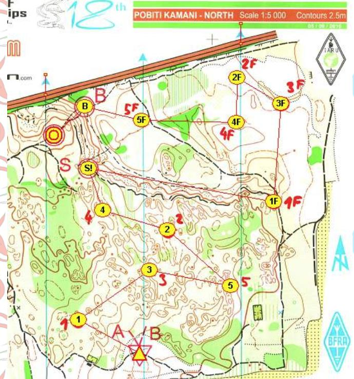
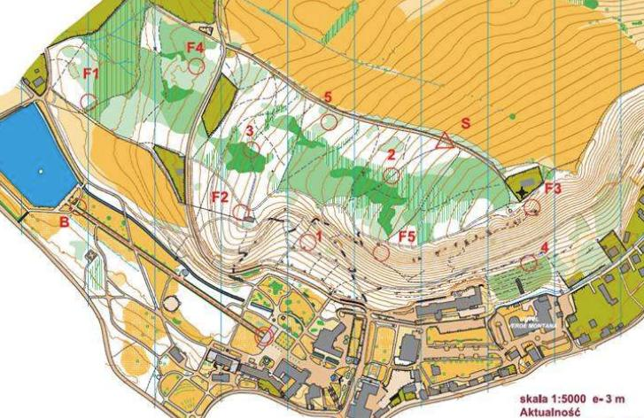

# Stavba sprintu
Sprint je nejrychlejší a zároveň nejtechničtější disciplína ze všech zmíněných, její podstatou je vyhledávání velkého množství vysílačů ve vysoké intenzitě s malým časem na rozhodování. Směrný čas je pro všechny kategorie 15 minut -- při výrazně delší trati lze velmi obtížně dodržet vysokou intenzitu běhu. 

Při sprintu by se měly používat velké vysílače s limitovaným výkonem (typicky 1W). Při použití malých vysílačů bývá často jasné pořadí díky lepší slyšitelnosti některé z kontrol.

## Klíčové prvky stavby
- **Rychlé rozhodování** -- postupy mezi kontrolami by měly být rychlé, závodníci by se hned v první minutě měli rozhodnout pro nějaké pořadí. Je tak dobré držet kontroly kompaktněji u sebe.
- **Dobrá průběžnost** -- sprint by měl být stavěn v dobře průběžném terénu bez výrazných terénních nerovností, či případně veden ze svahu směrem dolů. Dlouhé výběhy, nutící závodníky ke zpomalení až do chůze, nejsou žádoucí.
- **Oddělené pomalé a rychlé kolo** -- němělo by se stát, aby závodník z jednoho kola probíhal kolem kontrol kola druhého. Vede to k zbytečným chybám v ražení a matení závodníků.
- **Jasně viditelné kontroly** -- samostatné stojany (i když pruhované) nejsou v lese dobře vidět. Schovávat je za stromy či za terénní nerovnosti vede k sdružování závodníků na kontrolách a jde proti principu sprintu.

Pro další inspiraci lze doporučit materiál o stavbě sprintu od Jiřího Marečka [zde](https://www.ardf-r1.org/files/Guides/ARDF_Sprint_Handbook_2017.pdf), pouze v angličtině.

## Umístění divácké kontroly
Ačkoliv se v ROB velké množství diváků nepohybuje, divácká kontrola by měla být umístěna tak, aby umožňovala případným divákům přístup. V ideálním případě by na diváckou kontrolu mělo být vidět ze stejného místa, jako je vidět na maják. Pokud tohoto nejde dosáhnout (např. díky charakteristice terénu), měl by mezi diváckou kontrolou a cílem možný přesun.

Od divácké kontroly lze vést naváděcí koridor, což se hodí obzvláště pokud je mezi rychlým a pomalým kolem nějaká překážka (zeď, potok atd.). Informace o takovém koridoru by měla být vždy uvedena v pokynech, aby se předešlo případným problémům.

Pravidla ROB umožňují místo samostatné divácké kontroly vícenásobné ražení majáku. Při stavbě s tímto lze pracovat, pokud se nenabízí lepší umístění divácké kontroly.

## Příklad dobře postavené tratě
Trať z MS 2016 v Bulharsku nabízí dobře průběžný terén (ekvidistance 2,5 m) s dobře odděleným pomalým a rychlým kolem. Diváci mají možnost sledovat průběhy jak na divácké kontrole, tak od majáku do cíle.

Pořadí není jednoznačné, závodníci musí volit díky blízkosti kontroly 2 a 3 a vysunuté kontrole F1. Časy vítězů se pohybovaly mezi 14--16 minutami. Celkově se jedná o velmi zdařilou trať. 

## Příklad hůře postavené tratě
Tato trať byla postavena na Mistrovství Evropy 2013. Terén je v tomto případě velice členitý a špatně průběžný, kontroly jsou umístěny na hranách hustníků, což výrazně komplikuje jejich hledání. Kromě toho se v prostoru nacházelo elektrické vedení, což komplikovalo zaměřování.

Pomalé a rychlé kolo se výrazně překrývá, což vedlo k nálezům F2 a F5 při hledání kontrol pomalého kola. Na doběhu je použitý velice dlouhý doběhový koridor, což je sice atraktivní pro diváky, ale pro závodníky je na konci takového závodu zbytečně dlouhý.

Vítězné časy ve všech kategoriích vyjma jedné přesáhly 20 minut a u dalších závodníků se pohybovaly i přes půl hodiny. 

