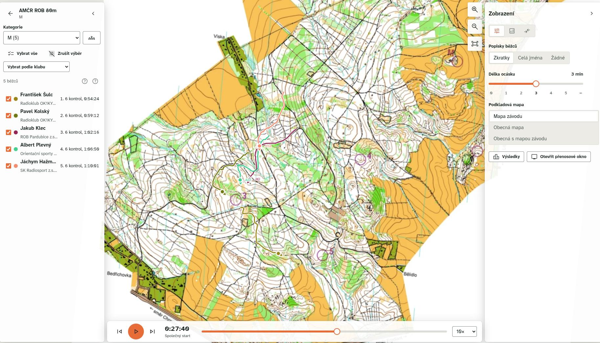
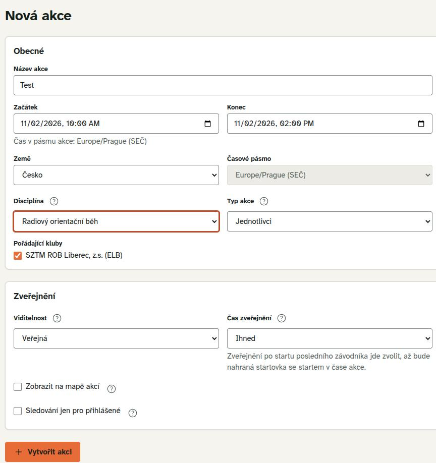
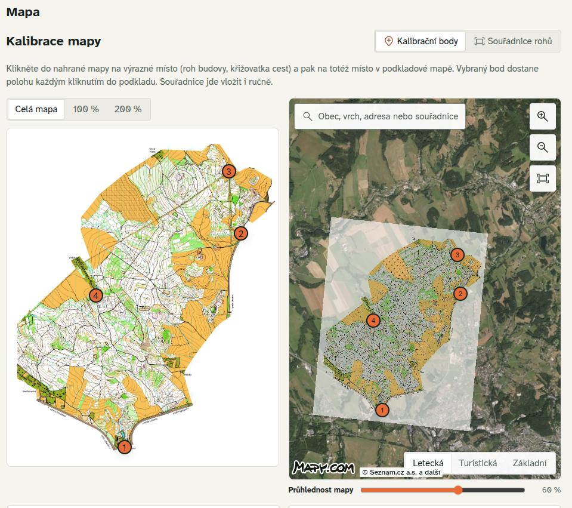
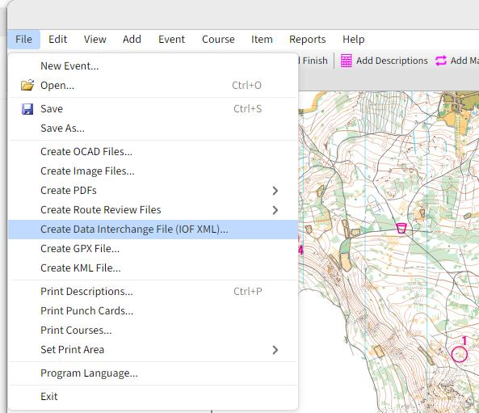
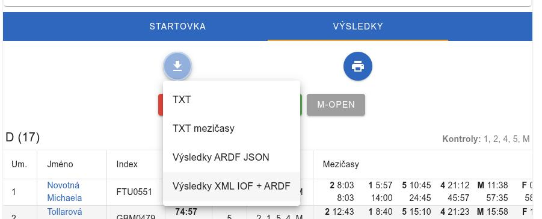
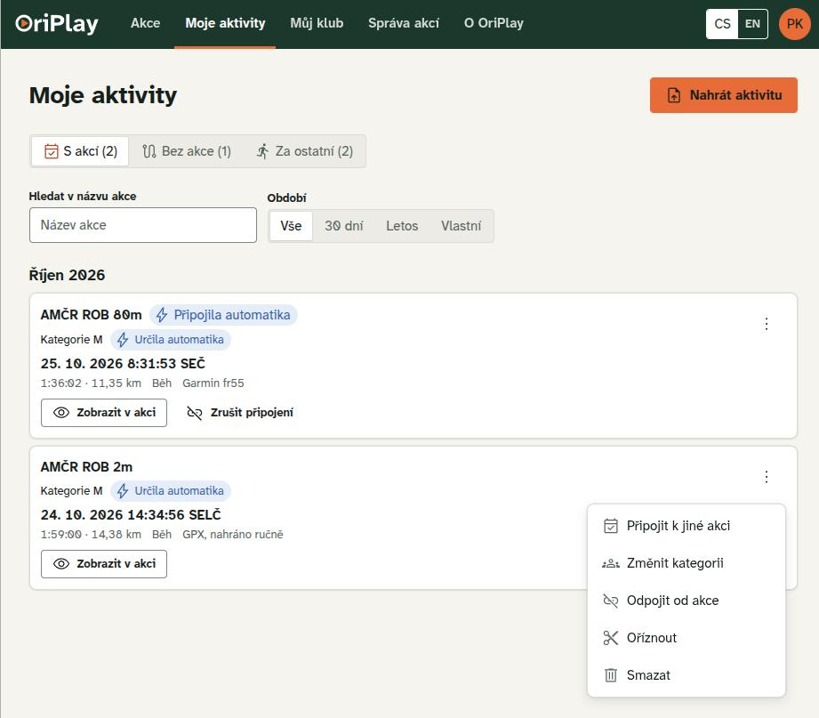

# OriPlay

OriPlay je nástroj pro pozávodní analýzu závodních postupů a živé sledování závodníků s trackery během závodu. Byl vyvinut jakožto náhrada za systém Livelox a pro členy AROB je k dispozici zdarma po přihlášení ROBis účtem. Kromě samotného zobrazení postupu umožňuje zobrazení ztrát mezi kontrolami volného pořadí a analýzu jednotlivých postupů.

## Správa akce
### Vytvoření akce a nahrání mapy
Akci může vytvořit libovolný správce daného klubu. V dialogu je potřeba vyplnit základní údaje, nastavit ROB jako sport a určit čas zveřejnění. Pokud se akce vytváří před soutěží, je potřeba nastavit čas zveřejnění tak, aby nedošlo k úniku informací.

Mapu lze nahrát v rastrovém formátu, či případně ve formátu OCD, který bude na rastr převeden. Kalibrační data lze poskytnout ve podporovaných formátech (.tfw, .jgw, .pgw nebo .wld) nebo lze mapu zkalibrovat pomocí výběru jednotlivých bodů na satelitní mapě. Pro správnou kalibraci je nutné zvolit alespoň 3 body, lepší je však použít 4 a více. Ručně zkalibrovaná mapa však bude vždy méně přesná, než georeferencovaný export, proto je preferované jej použít.

Tratě lze mít nakreslené přímo na mapě, ale je lepší je importovat z formátu IOF XML či z PurplePenu. Preferovaný formát je XML, jelikož data ukládá v podobě geografických souřadnic. Export se provádí přímo v programu použitém pro stavbu tratí.

### Import startovek / výsledků
Aby docházelo k automatickému párování závodníků s nahranými aktivitami a byla možná detailní analýza mezičasů, je potřeba nahrát startovky / výsledky ve formátu XML. Ty se dají exportovat z ROBisu na konkrétní stránce daného závodu.

## Nahrávání postupů
Závodníci své postupy mohou buď nahrávat automaticky ze spárovaných služeb (Garmin, Coros, Polar atd.), či manuálně ze souboru GPX. Pro automatické propojení je potřeba spárovat službu před synchronizací hodinek, starší aktivity je nutné doplnit ručně.

Pro nastavení párování je potřeba přejít do nastavení, konkrétně do sekce **Propojené aplikace**. Následně je uživatel vyzván k přihlášení do dané služby a potvrzení možnost synchronizace aktivit. Poté se nahrané aktivity automaticky synchronizují i do OriPlay. 

Samotné spojení aktivit s událostí by se po nahrání výsledků mělo provést automaticky, případně jej lze provést ručně v sekci **Moje aktivity**. Na stejném místě lze také párování zrušit pomocí volby **Odpojit od akce**.

<!-- Doplnit živé sledování -->
