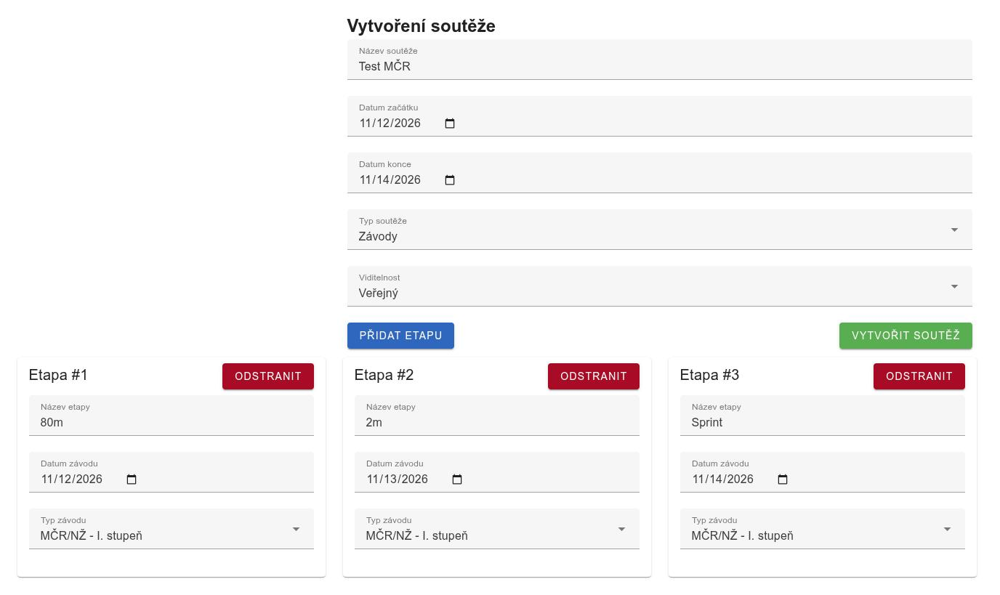
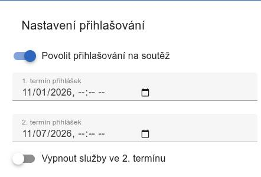
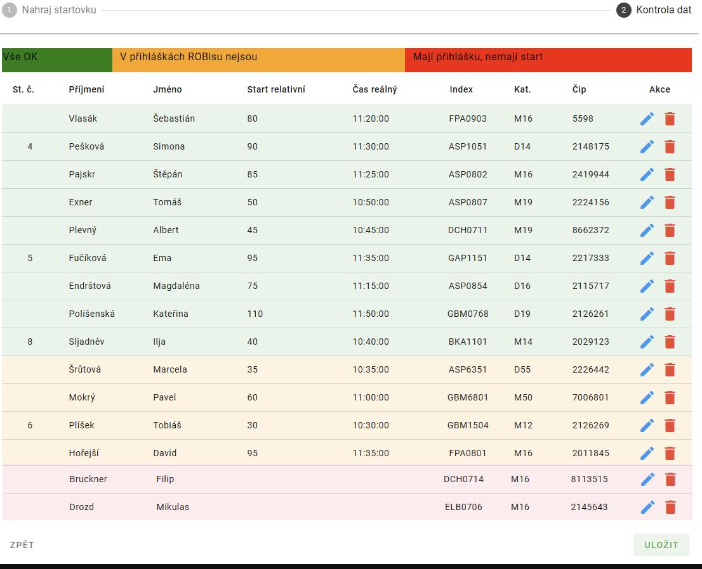
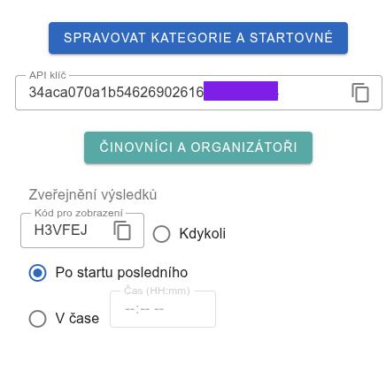

# ROBis
ROBis je informační systém určený pro pořádání soutěží v radiovém orientačním běhu. Jeho cílem je poskytnout jednotnou databázi závodníků a jejich výsledků, včetně dalšího automatického zpracování (počítání žebříčků, VT atd.). Použití ROBisu při soutěži výrazně ulehčuje organizátorům práci při zveřejňování informací, sběru přihlášek a nahrávání výsledků.

ROBis disponuje poměrně obsáhlou [nápovědou](https://rob-is.cz/napoveda), kromě toho jsou k dispozici i [videonávody](https://www.youtube.com/watch?v=hZCVdPvOV_Y&list=PLLVX8tK3b7fXsCYiwQtSJuid7DYc-9sJ-). Z toho důvodu se zde zaměříme pouze na klíčové prvky při pořádání soutěže.

## Vytvoření a správa soutěže
Soutěže může vytvářet kdokoliv s pravomocí organizátor. Tu může udělit správce daného oddílu. Pokud vytváříme soutěž s více etapami, dbáme na správný druh (národní / krajská / regionální) soutěž.

*Vytváření soutěže a jednotlivých etap.*

## Přihlášky
ROBis umožňuje dva termíny přihlášek, se zvýšeným startovným  a možným vypnutím objednávek ubytování a stravy pro druhý termín. Termíny jako takové se nastavují na hlavní stránce soutěže.

*Nastavení termínu přihlášek.*

## Startovky a výsledky
Startovky a výsledky pro každou etapu lze nahrát dvěma způsoby:
- **přímo z vyčítacího programu** -- pokud toto vyčítací SW podporuje, je možné data nahrát přímo z programu. K tomu je zapotřebí použít API klíč, dostupný na záložkách pro jednotlivé etapy.
- **ze souboru** -- z vyčítacího SW se vyexportuje soubor a následně se manuálně nahraje na ROBis.

*Nahrávání dat ze souboru.*

## Průběžné výsledky

Pokud to vyčítací program umožňuje, je možné v průběhu soutěže zveřejňovat průběžné výsledky. Jelikož je možné, že první závodníci doběhnou před startem posledních, lze nastavit specifický čas zveřejnění výsledků. Do té doby je pro zobrazení potřeba zadat alfanumerický kód, který je opět k dispozici pro každou etapu.

*API klíč a klíč pro zobrazení průběžných výsledků s možností nastavení doby zveřejnění.*
