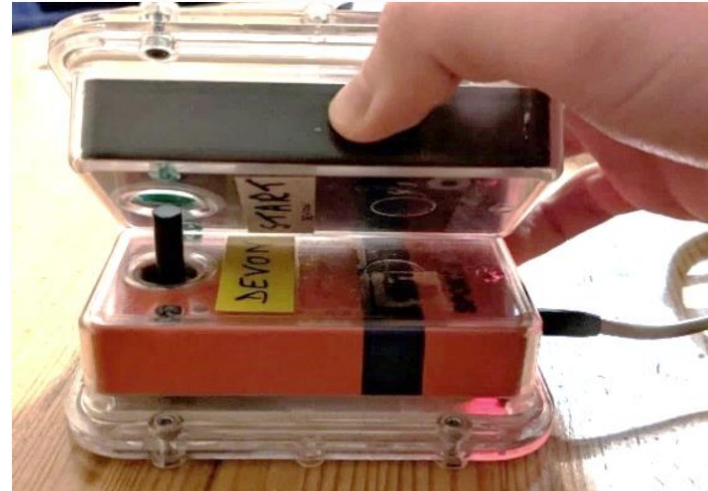
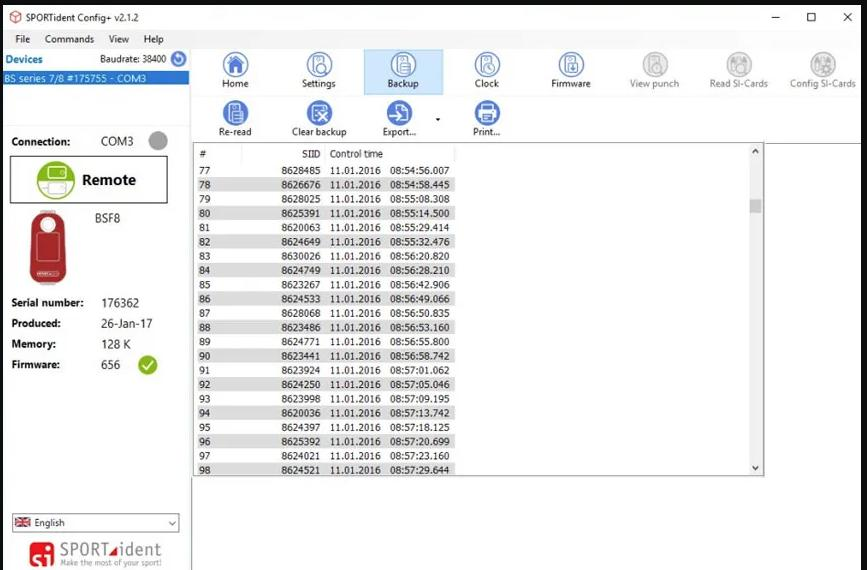

# Sportident

U naprosté většiny soutěží je v současnosti využito elektronické ražení Sportident. Systém je jednoduchý, funkční a dostatečně spolehlivý. Dá se využívat jak v kontaktním, tak bezkontaktním módu ražení, přičemž jednotky v bezkontaktním módu lze razit i kontaktním způsobem.

Před samotnou soutěží je potřeba jednotky naprogramovat a sesynchronizovat. Pro programování se používá program SI Config+, který je k dispozici na stránkách výrobce a je k němu poskytován [detailní návod](https://docs.sportident.com/user-guide/config-plus). Funguje pouze pro Windows, nicméně je možné jej provozovat ve virtuálním stroji při povolení USB.

Zejména důležité je následující:
- **Zkontrolovat správný mód kontroly a kód** -- jednotky lze nastavit do více módů (CLEAR, CHECK, kontrola), stejně tak může být každá jednotka naprogramovaná s libovolným kódem. V ROB se standardně používají hodnoty 31-36 pro pomalý okruh, 41-45 pro rychlý okruh a 99 pro maják, nicméně lze použít libovolné jiné hodnoty.
- **Mít dobře seřízený čas na PC před synchronizací jednotek** -- u většiny PC se stačí před programováním připojit k internetu, přičemž operační systém automaticky čas sesynchronizuje. Doporučuje se však ověřit pomocí dalšího zdroje (například GPS hodinky).
- **Před začátkem soutěže krabičky probudit** -- každá jednotka má nastaven čas operace, po který je v aktivním módu. Pokud tato doba uplyne bez oražení, jednotka se přepne do úsporného módu, ve kterém bezkontaktní ražení nefunguje a kontaktní ražení trvá déle. Proto je potřeba před/při roznosu krabičky probudit pomocí oražení.

*Programování SI jednotek pomocí vyčítací jednotky připojené přes USB.*

## Vyčtení paměti jednotek
Pokud při závodě dojde k problému při zápisu do čipu (obvykle chybou závodníka, který nepočkal dostatečně dlouho), je možné vyčíst záložní paměť jednotky, kam se ukládají jednotlivá **kontaktní** ražení. V případě bezkontaktního ražení se data do paměti jednotky neukládají a tím pádem ji nemá smysl vyčítat.

Vyčtení paměti se opět provádí pomocí programu SI Config+, v záložce Backup. Záznamy se dají exportovat ve formátu CSV pro jednodušší filtraci a vyhledávání.

*Vyčítání záložní paměti SI jednotky pomocí programu SI Config+.*