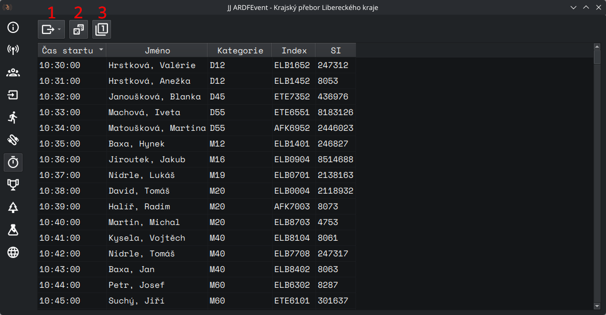
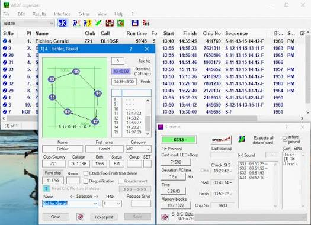
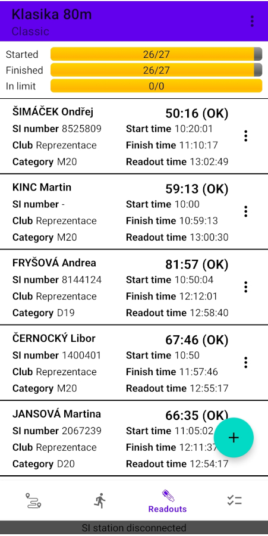
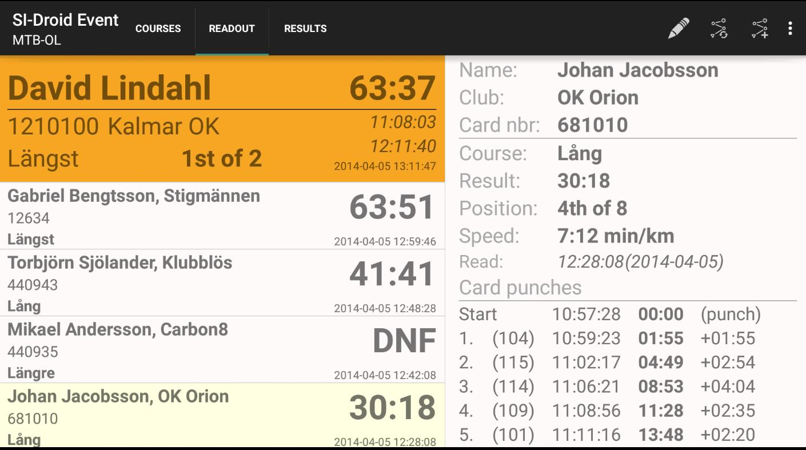

# Vyčítání a zpracování výsledků

Pro vyčítání je potřeba SI jednotka s USB kabelem, případně ještě USB-C adaptér při použití mobilní aplikace. Pokud chceme závodníkům tisknout lístek s mezičasy, je potřeba ještě účtenková tiskárna s dostatkem termopapíru. Chceme, aby vyčtení čipu byla první věc, kterou závodník po svém doběhu do cíle provede, z toho důvodu umisťujeme vyčítání co nejblíže cílové čáry.

Průběžné výsledky zveřejňujeme buď online, nebo formou "špagátostroje", při kterém tiskneme lístky dvakrát a následně je připínáme na napnutý provázek. Ideální je kombinace obou přístupů, ne všichni mají v cíli s sebou mobilní telefony.

## Programy

Pro ROB existuje poměrně velké množství vyčítacích programů, které se liší dostupnými funkcemi, ovládáním, či podporovanými platformami. Následující výčet rozhodně není kompletní, jeho cílem je pouze poskytnout krátký přehled.

### JJ ARDF Event
Open source program pro zpracování ROB výsledků vyvíjený Jakubem Jiroutkem. Umožňuje vyčítání výsledků jak na Windows, tak na Linuxu. Podporuje přímou integraci s ROBisem (automatické stahování dat, nahrávání startovek a výsledků) a generování různých tiskových sestav. Program byl ozkoušen na více závodech 1. stupně a v plánu jsou další úpravy a vylepšení.

[Stránka projektu](https://github.com/ARDFEvent/ARDFEvent)

### ARDF Fjww
Německý placený program, který je ve světě prakticky standardem -- ozkoušen byl na mnoha Mistrovstvích světa a Evropy. Umožnuje import dat z Excelu, losování startovních listin dle mezinárodních pravidel, automatické počítání vzdušné délky postupu atd. Nevýhodou je poměrně nepřehledné uživatelské rozhraní a strmá učící křivka. Navíc funguje pouze pod Windows.

[Stránka projektu](http://www.dl7vdb.de/index_eng)

### Radio-O Manager
Open source Android aplikace, určená pro co nejjednodušší vyčítání soutěže v ROB. Umožňuje přímou integraci s ROBisem včetně importu dat, nahrávání startovek a průběžných výsledků. Exporty jsou k dispozici v různých dalších formátech (TXT, HTML, CSV). Vhodná je pro středně velké soutěže a tréninky. 

[Stránka projektu](https://github.com/kolskypavel/Radio-O-Manager/wiki)

### SI-Droid Event
Android aplikace určená pro klasický OB, ale s módem scorelauf lze použít i pro ROB. Použitelná verze je placená (cca 120 korun). Je vhodná k použití na malé tréninky / okresní soutěže, na větší akce se díky nutnosti manuální kontroly ražení nehodí.

Výsledky lze importovat po skončení soutěže do ROBisu, více viz nápověda.

[Odkaz na stažení](https://play.google.com/store/apps/details?id=se.joja.sidroid.event.full&hl=cs)

