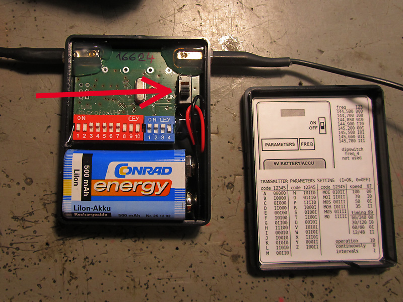
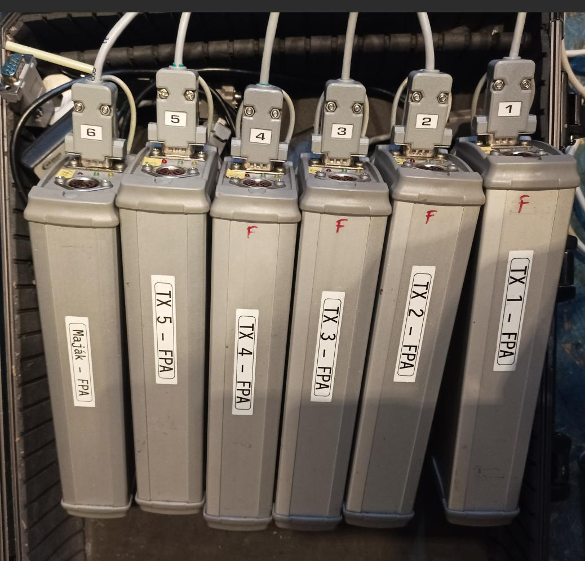
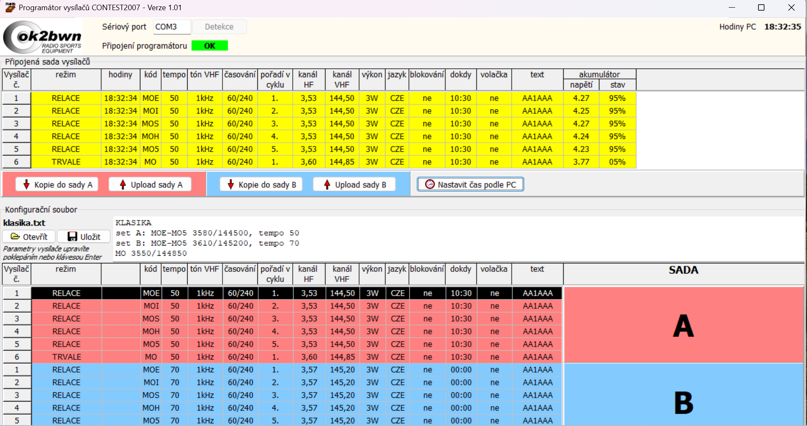

# Příprava vysílačů

Vysílače je před samotným použitím nutné zkontrolovat a připravit. Bez ohledu na použitý typ vysílače se vysílače nabíjí určenou nabíječkou a následně je nutné je naprogramovat podle typu soutěže.

## Programování vysílačů Trainer a Microfox
Tyto vysílače se programují manuálně pomocí DIP přepínačů pod krytem vysílače. Postupuje se podle návodu od výrobce a po programování je potřeba ověřit správnost konfigurace pomocí přijímače.

Vysílače jako takové nemají přesný čas, tím pádem se musí zapínat v momentě začátku relace. Novější vysílače Microfox disponují dvěmi vypínači, kde vnitřní zapíná časovou jednotku a druhý samotné vysílání. Tím pádem lze vysílače připravit a zkontrolovat předem a následně v lese již pouze provést montáž a zapnout vysílání.

*Programování vysílače Microfox. Starší model pouze s jedním vypínačem, vysílač je tedy nutné zapnout na začátku relace. Foto [OK2PPK](https://ok2ppk.cz/index.php?pg=fgal&gal=rob180507).*

## Programování vysílačů CONTEST

Vysílače CONTEST se programují buď pomocí malého ovládacího panelu, nebo programátoru za použití PC. Druhá možnost je výrazně jednodušší a méně náchylná na chyby, tudíž je preferována, kdykoliv je to možné.

Vysílače se zapojí pomocí programátoru v očíslovaném pořadí, program by měl detekovat jejich připojení a ukázat jejich současný stav. Ukazatel nabití vysílačů má tendenci nebýt úplně přesný, tj. je potřeba se řídit buď voltmetrem, nebo v případě jeho absence poskytnutou nabíječkou s ukazatelem stavu.

*Zapojení vysílačů CONTEST pro programování přes PC.*

Program umožňuje připravit najednou konfiguraci pro celou sadu a tu následně nahraje do vysílačů pomocí tlačítka **Upload do sady A/B**. Tyto konfigurace lze uložit do textového souboru a následně opět nahrát. Pro normální disciplíny a standardní frekvence jsou k dispozici následující [připravené soubory](../../assets/konfigurace_contest.zip).

Po nahrání konfigurace by měly být vidět projevené změny v aktuálním nastavení vysílačů. Následně je ještě potřeba sesynchronizovat čas vysílačů s reálným časem pomocí tlačítka **Nastavit čas podle PC**. Stejně jako u SI jednotek je potřeba zkontrolovat správný čas na PC (obvykle stačí předtím připojit PC k internetu). Občas je nutné provést synchronizaci několikrát, než se správný čas do vysílačů přepíše.

*Programování vysílačů CONTEST pomocí dodaného SW.*
