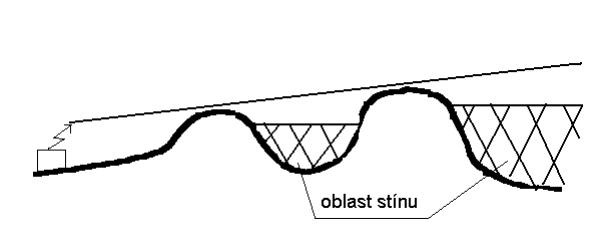
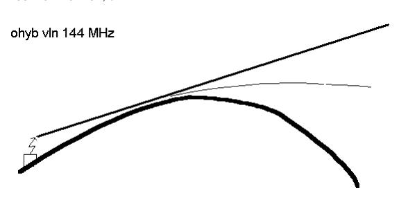
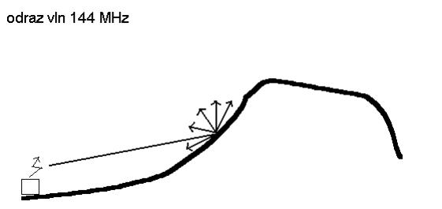
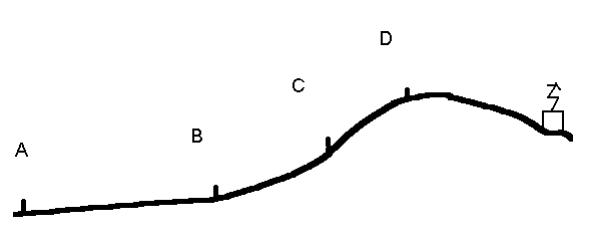
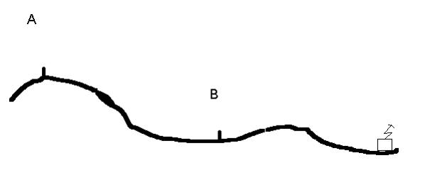

# Zaměřování

Správné zaměřování je alfou omegou ROB. Pochopení základních principů obvykle nebývá problematické, pouze u osmdesátky se začátečníkům plete posloupnost kroků a správné držení přijímače. O to déle však trvá vybroušení dovedností do automatičnosti, kdy i u velmi zkušených jedinců lze často pozorovat nedostatky, zejména pak při práci s dvoumetrem. Jak už bylo zmíněno, na zjištěné chyby je nutné upozorňovat a opravovat je, aby nepřerostly ve zlozvyk.

U některých svěřenců se při zaměřování projevuje podvědomá snaha stáčet směr ve prospěch lepšího terénu / postupu (oblíbené například u odbočování z cesty). Problém tohoto jednání je nejvíc markantní na konci relace, kdy nabrání španého směru může vést ke zbytečnému minutí kontroly. 

## Pásmo 3,5 MHz

Pokud učíme zaměrovat začátečníka, který drží poprvé přijímač v ruce, pohyby nezrychlujeme a dbáme na správný náklon rádia.

Postup je následující:
1. Naladíme požadovanou frekvenci
2. Otočíme přijímač ve směru feritové antény 
3. Hranou rádia zjistíme minimum signálu, které přichází ze dvou směrů (před a za tělem). 
4. Otočíme přijímač ladícími kolečky směrem k sobě
5. Stiskneme a držíme tlačítko předozadního poměru
6. Ověříme, který ze směrů je silnější - to je správný směr kontroly

Ověření směru se dá provádět dvěma způsoby -- úplným otočením celého těla, či pouze protočením rádia. Druhý způsob je rychlejší, nicméně je pro začátečníky matoucí a často vede k následným chybám při držení rádia. Proto bychom (zejména u dětí) měli začínat s otáčením celého těla a až později přecházet k protáčení rádia.

### Zaměřování na foxoringu
U foxoringu bychom díky omezenému výkonu měli slyšet kontrolu ze středu kolečka. Často však nabíháme z různých směrů a vyplatí se tak ladit co možná nejdříve, přičemž se snažíme maximalizovat hlasitost signálu bez výrazného vlivu šumu. 

Postupujeme tak následovně:

1. Naladíme frekvenci
2. Hlasitost nastavíme tak, abychom stále slyšeli užitečný signál, nikoliv šum (typicky hlasitost cca 5-6)
3. Přijímač umístíme co nejvýše
4. Držíme zmáčknuté tlačítko prutové antény
5. Postupujeme směrem ke kontrole do té doby, dokud není signál dostatečně hlasitý a můžeme zaměřovat normálním způsobem.

Někteří závodníci při dohledávání preferují zaměřování tzv. **na kosu** -- rádio drží naležato, tlačítko prutové antény stisknuté a dohledávají maximum signálu. Tato technika obvykle funguje spolehlivě do blízkosti řádově 20-30 metrů, poté se vyplatí přejít na techniku normálního zaměřování pro přesné nalezení vysílače.

### Zaměřování v blízkosti rušivých prvků
Jako rušivé prvky označujeme kovové konstrukce, které negativně ovlivňují zaměřování přijímačů v pásmu 3,5 MHz (oplocenky, elektrické vedení, potrubí atd.). Těmto prvkům se snažíme co nejvíc vyhýbat, neumisťujeme v jejich blízkosti kontroly atd.

Pokud potřebujeme zaměřovat v blízkosti elektrického vedení (např. postup vede po cestě s vedením), je potřeba odběhnout minimálně do vzdálenosti, jaká je výška daného stožáru (ideálně více). Na tuto skutečnost je nutné svěřence upozornit při tréninku / závodech v prostoru s obdobnými prvky.

## Pásmo 144 MHz

Ačkoliv je princip měření s dvoumetrem jednodušší (měříme na nejsilnější), správné provedení je složitější, než s osmdesátkou. Na vině je charakteristika šíření rádiových vln v tomto pásmu (viz níže), která je odlišná od pásma 3,5 MHz.

Obecné zásady měření s dvoumetrem:
- **Neustálý pohyb** -- při měření s dvoumetrem nelze jako u osmdesátky postupovat staticky. Je nutné neustále ověřovat správný směr signálu (který se může nacházet za tělem!). Proto i po "čistém" záměru neustále měříme, minimálně v rámci půlkruhu před tělem.
-  **Držení přijímače co nejvýšše** -- čím výš se nacházíme, tím lépe by měl dvoumetr měřit. Proto kromě samotného držení co nejvýšše nad hlavou vyhledáváme i vyvýšená místa, odkud můžeme lépe zaměřit.
- **Náběhy zvrchu** -- na kontrolu na dvoumetru nabíháme vždy zvrchu, jinak je velmi jednoduché kontrolu nedoběhnout, zaměřit odražený signál atd. Občas je lepší vystoupat větší počet vrstevnic, než ztratit dvě relace na dohledávce ve svahu.
- **Hlasitost neodpovídá vzdálenosti** -- pokud máme kontrolu na přímou viditelnost (například přes údolí), může být lépe slyšet než bližší kontrola za terénní překážkou. Proto při volbě pořadí a zaměřování nevěříme hlasitosti samotné, ale jejímu **zesilování v rámci relace**.
- **Zesílení udržovat nízko** -- pokud máme zesílení hlasitosti nastaveno na moc velkou hodnotu, přijímač má tendenci se zahltit signálem a následně již nepoznáme maximum. Proto je důležité začínat na nížších hodnotách a postupně zesilovat. Vyhneme se tak i nepříjemnému "prásknutí" do uší.

### Charakteristika šíření signálu v pásmu 144 MHz

Následující text je převzatý z publikace V. Vlachové o tréninku mládeže v ROB.[^1] Lze z něj poměrně dobře pochopit, proč se dvoumetr při zaměřování chová poměrně nedeterministicky.

V pásmu 144 MHz se vlna šíří obdobně jako světlo:
- šíří se přímým směrem, nešíří se za překážkou
- špatně se ohýbá
- odráží se o překážku a láme se 

V rovinatém terénu se vlna šíří přímým směrem. Objeví-li se ve směru šíření překážka, vlna se šíří až do místa dopadu na překážku. Za překážkou, v údolí a za kopci nebo budovami vznikají ostré stíny, ve kterých je signál slyšet velmi slabě nebo není slyšet vůbec. V takovém případě je nutné vycházet z předchozího zaměřování a pokračovat směrem původního zaměření až do doby, kdy signál znovu uslyšíme.

Dopadá-li rádiová vlna na rozhraní dvou prostorů nebo hranu
překážky, dochází k ohybu. Tento ohyb je však velmi malý.

Při dopadu rádiových vln na překážku dochází stejně jako u světla k jejímu lomu. Protože však rádiová vlna nedopadá na rovnou plochu, nelze úhel dopadu přesně určit a dochází k mnohasměrnému odrazu - roztříštění vlny. Takto odražený signál je vždy slabší než ten, který na překážku dopadl.

#### Chování signálu v kopcovitém terénu
V členitém terénu se pak střídají oblasti stínů s přímou
viditelností z vrcholků kopců a tím se mění i síla a směry signálů. Základem zaměřování je nutnost zaměřovat v pohybu a pokud možno ne v údolí nebo pod kopcem. Proto se vždy před začátkem relace snažíme dosáhnout co nejvyššího místa ve směru postupu (vrchol kopce).

**Vysílač za kopcem (za horizontem)**

- A - signál je silný, směr jednoznačný
- B - signál začíná slábnout
- C - signál je velmi slabý (oblast stínu)
- D - signál je opět silný, směr jednoznačný 

**Vysílač za překážkou**

- A - síla signálu je dobrá (útlum je stažený na polovinu)
- B - síla signálu je slabší (na stejnou sílu signálu jako v A musíme zesílit hlasitost) 

### Tréninky zaměřování v pásmu 144 MHz
- **Dvoumetr v kopci** -- pro tento trénink je potřeba poměrně velký, rozsáhlý kopec, ideálně s výraznou linií / cestou veprostřed. Vysílače nastavíme na klasické relace a umístíme je do různých výšek (na úpatí, těsně za hranu svahu, úplně nahoru atd.). Svěřence nejprve necháme přejít kopec z jedné strany na druhou podél linie a během celé doby mají za úkol zaměřovat. Následně je postupně odstartujeme zpět s cílem najít všechny kontroly. Svěřenci by měli pozorovat změny v chování signálu oproti prvnímu přechodu v závislosti na viditelnosti (oblasti stínu) a vzdálenosti.
- **Seběh svahu** -- obdobné tréninku v kopci, všechny kontroly umístíme do svahu a startujeme zezhora. Je možné zadat pořadí vyhledávání vysílačů (ideální / neideální). 

[^1]: VLACHOVÁ Vlasta, Trénink mládeže v ROB, 2008 - [odkaz](https://ardf.cz/images_obsah/1225903406-trenink-mladeze.pdf)