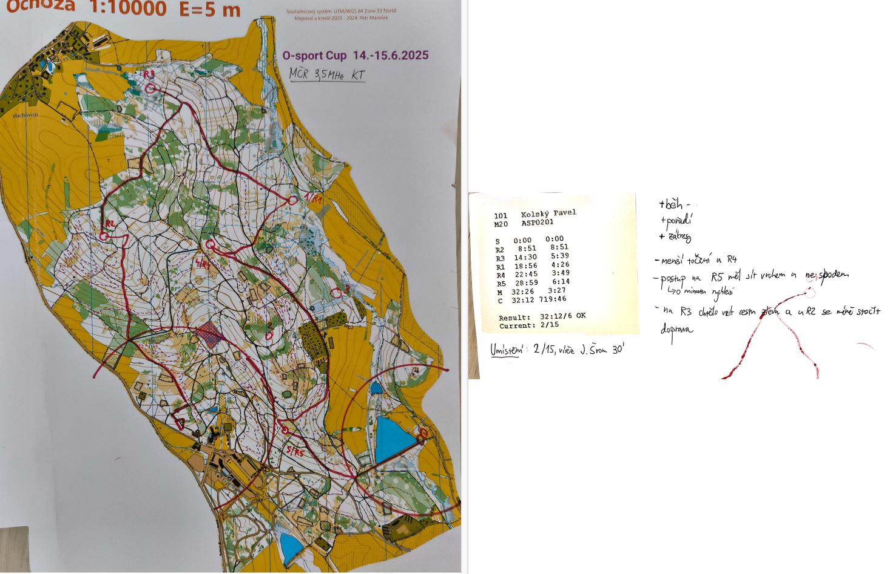
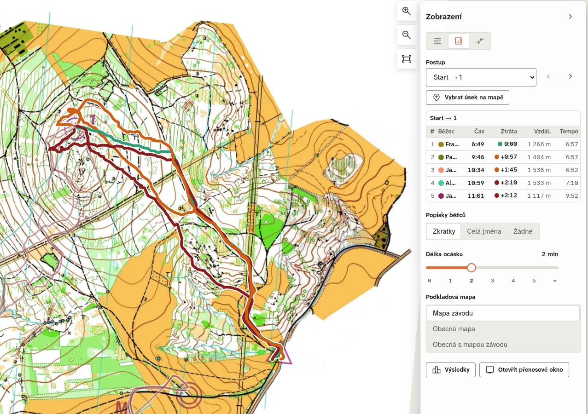
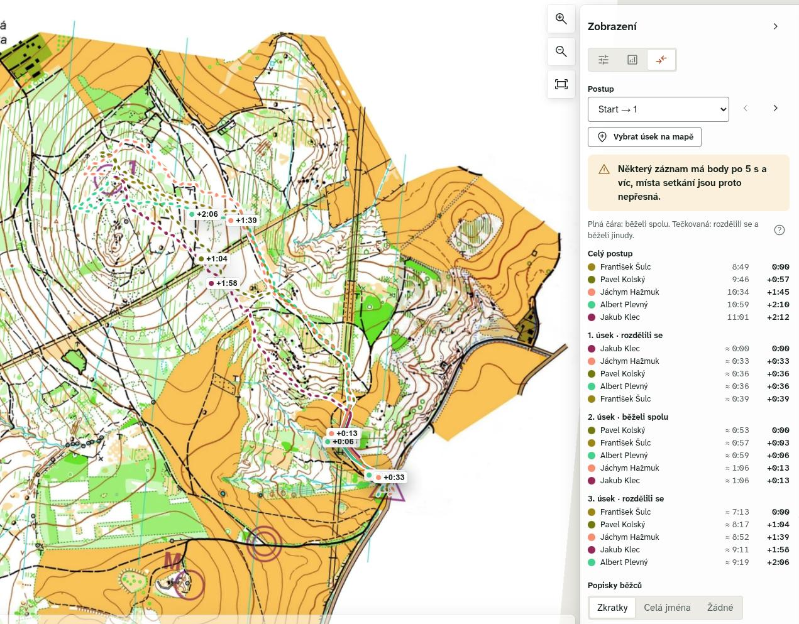

# Analýzy postupů

Pozávodní / potréninkovou analýzou postupů svěřenci reflektují svůj výkon a lépe si uvedomují své chyby na trati. Pro trenéra se jedná o důležitou zpětnou vazbu, kterou nelze získat ze samotných mezičasů a zároveň má možnost "nahlédnout" do chování závodníka při běhu.

Analogicky jako u tréninkových deníků lze provádět analýzy papírově i elektronicky. Papírová analýza nad mapou nutí svěřence k důslednějšímu zamyslení nad svými postupy a uvažováním v dané situaci, elektronická je přesnější a umožňuje porovnání napříč závodníky. Ideální je v tomto případě kombinovat oba dva způsoby, kdy se nejprve postupy nakreslí na mapu a posléze zkontrolují pomocí záznamu z hodinek.

## Papírová analýza
Papírová analýza by měla obsahovat minimálně následující položky:
- Mapu se správnou pozicí kontrol
- Zakreslený postup
- Lístek s mezičasy
- Čas vítěze
- Povedené aspekty
- Chyby na trati

Každý závodník by si měl vést svůj personální archiv map, ke kterému se může následně vracet. Nejen že se může znovu zamyslet nad svými chybami z daného závodu / tréninku, ale také má k dispozici mapu, kdyby se závody konaly ve stejném prostoru. 

*Příklad papírové analýzy postupů z MČR KT 2025.*

## Elektronická analýza
K elektronické analýze jsou potřeba data z hodinek a rastr / OCD mapy závodního prostoru. Pro analýzu se používá systém [OriPlay](https://oriplay.eu/), návod na samotné zprovoznění je stejný jako při [pořádání soutěže](../../rozhodci/technologie_poradani/technologie_poradani_oriplay.md).

OriPlay umožňuje běžné funkce jako přehrávání více postupů najednou při různých rychlostech, ale i specifické funkce pro ROB. Zejména užitečná funkce je Analýza postupů, která umožňuje porovnat postupy mezi kontrolami s volným pořadím, což většina ostatních programů neumí.

*Funkce analýzy postupů v aplikaci OriPlay. V tabulce jsou vidět vzdálenosti a doby trvání.*

Další použitelnou funkcí jsou Ztráty, které ukazují, kolik daný závodník na postupu mezi kontrolami ztratil na ostatní. Hodí se v případě, že mezi závodníky nejsou velké výkonostní rozdíly, protože jinak bývají způsobeny lepší fyzickou formou.

*Funkce ztráty na postupu v aplikaci OriPlay. Tečkovaná čára značí, kdy se závodníci na postupu rozdělili.*