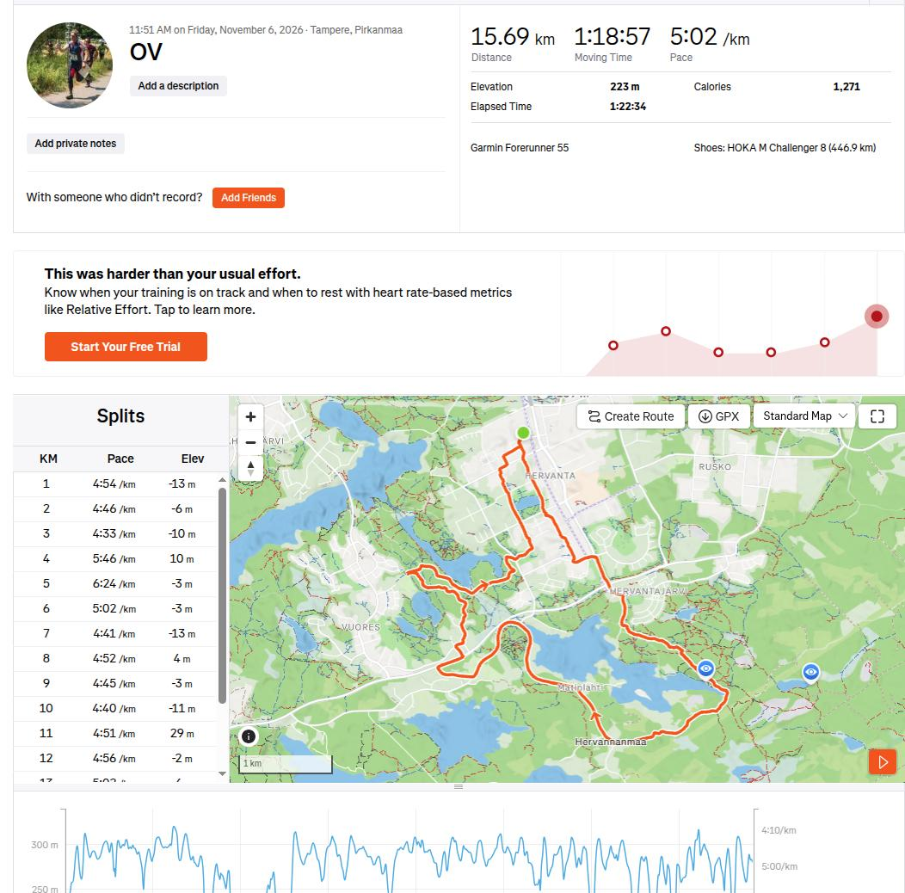

# Tréninkové deníky

Tréninkový deník slouží pro záznam uplynulých aktivit, kontrolu plnění tréninkového plánu a jako podklad pro možné úpravy v tréninkovém procesu. V případě zranění či snížené výkonnosti se díky záznamům dá zpětně dohledat důvod a obdobnou aktivitu z tréninku vyloučit.

Tréninkový deník lze vést více způsoby:
- **Papírově** -- jednoduché, avšak obtížné na kontrolu trenérem a časově náročné
- **Elektronicky do tabulky** -- prakticky obdoba papírového, ale lépe se kontroluje trenérem
- **Pomocí speciálních aplikací** -- nejjednodušší, aktivity jsou automaticky nahrávané po vyčtení hodinek, avšak většinou se hůře udržuje specifická struktura

Je na výběru každého trenéra + svěřence, jakou formu se rozhodnou využít. Tréninkový deník by se měl stejně jako plán průběžně doplňovat a kontrolovat. Ideální je záznamy o uplynulém tréninku doplnit bezprostředně po něm, jelikož pak se jedná o malé množství práce a svěřenec si pamatuje detaily. Kromě tréninkových jednotek by v deníku měly být uvedeny záznamy o nemocech / zranění, zejména těch dlouhodobých.

Každý tréninkový záznam by měl minimálně obsahovat:
- **Typ aktivity** -- běh, ROB, OB, běžky...
- **Dobu trvání**
- **Naběhané / ujeté kilometry** -- případně provedené cviky u posilování
- **Pocit z tréninku** -- těžký, lehký, mapově náročný atd. Právě tyto poznámky bývají důležité pro případnou úpravu tréninkového plánu.

Sportovní hodinky umožňují zaznamenávat další údaje, jako je trasa, srdeční tep, kadence atd. Pokud je možnost sportovní hodinky využít, je to pro trénink lepší, jelikož naměřené údaje jsou výrazně přesnější, než odhady svěřenců. Obzvláště při běhu mimo vyznačené cesty je odhadování reálné vzdálenosti velmi nepřesné.

## Elektronické aplikace
Většina výrobců hodinek dodává i samostatný software pro zpracování aktivit, včetně doporučených tréninků atd. Nevýhodou je, že svěřenci obvykle používají hodinky různých výrobců a není tak jednoduché se sejít na jedné aplikaci. V současnosti má nejvíce lidí hodinky od firmy Garmin, která poskytuje svojí aplikaci Garmin Connect, ve které lze vytvářet vlastní kluby a následně v nich porovnávat aktivity.

Velká část běžců používá pro své aktivity sociální síť Strava. Ta ovšem v základní verzi neobsahuje spoustu funkcí, které by se hodily pro správu tréninkového procesu a je nutné za ně platit. Na některé potřebné funkce (plánování, kontrola, nemoci) není vůbec stavěná. Z těchto důvodů se Stravu nedá doporučit jako primární tréninkový deník, pouze jako podpůrná motivace mezi svěřenci.

*Příklad aktivity v aplikaci Strava.*

<!-- Doplnit vhodnou aplikaci. -->