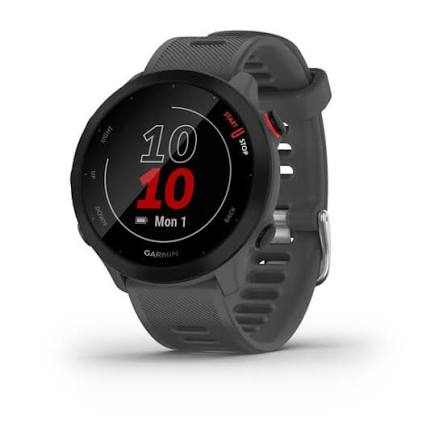
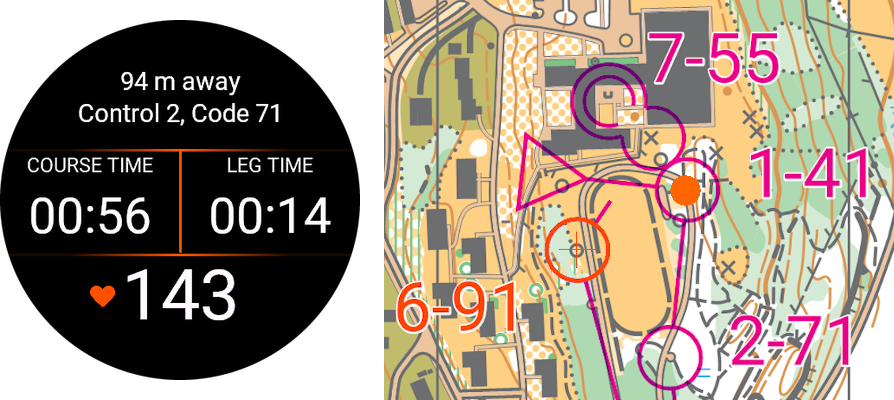

# Sportovní hodinky

Sportovní hodinky patří mezi téměř povinnou součást výbavy pokročilejšího běžce. Dle výrobce a použitého typu umožňují nejen sledování aktivit, ale i plánování doporučených tréninků, měření srdečního tepu, odhady VO2 max, navigaci atd. Vždy je na zvážení, které z těchto funkcí člověk reálně využije. Navíc dle pravidel ROB by hodinky neměly obsahovat digitální mapy terénu a možnost externí komunikace například pomocí mobilních sítí, což výběr mírně omezuje.

Dobré hodinky na ROB by měly být odolné, lehké, umožňovat dostatečně přesné sledování polohy a ideálně i měřit intervalové tréninky a srdeční tep. Tyto vlastnosti již dnes splňuje většina modelů (včetně základních) od renomovaných výrobců sportovních hodinek (Garmin, Polar, Suunto, Coros...). Naopak se většinou nehodí hodinky od běžných výrobců mobilní elektroniky (Apple, Samsung, Xiaomi ...), jelikož buď nejsou odolné, či obsahují nedovolené funkce.

*Hodinky Garmin Forerunner 55 – vhodný počáteční model pro ROB.*

## Použití sportovních hodinek
Kromě samotného měření aktivit obsahuje většina hodinek různé další možnosti -- zejména se hodí nastavit si různá datová okna (např. zobrazení tepu a času místo rychlosti). Pro intervaly je potřeba vypnout si automatické zaokrouhlování kol na kilometry a kola pak měřit manuálním stiskem tlačítka. Popis jednotlivých funkcí lze najít v manuálu od výrobce.

U většiny hodinek lze také navolit manuální složení intervalového tréninku se specifickým množstvím opakování, délek úseků atd. Svěřencům tak lze například poslat interval na individuální trénink, kdy jim hodinky automaticky oznámí začátky / konce úseků, odpočítají pauzu atd.

Pro trénink mapové přípravy lze použít aplikaci pro zařízení Garmin [O-Range](https://www.o-range.no/index.php), díky které není nutné do terénu roznášet fyzické lampiony -- v případě doběhu na kontrolu aplikace sama pozná z polohy oražení kontroly. Kromě toho umožňuje manuální záznam průběhu v případě, že signál GNSS není tak přesný. Na jejich stránkách lze najít databázi stacionárních kontrol a tratí, která bohužel v ČR není moc obsáhlá. Aplikace je dostupná ve dvou verzích podle typů zařízení -- ve verzi Basic jsou podporovany i méně výkonné typy.

*Aplikace O-Range pro trénink OB bez roznesených kontrol.*

## Snímače srdečního tepu
Pokud je v tréninku snaha využít běhání na přesnou tepovou frekvenci, je potřeba použít externí snímač tepu, nikoliv pouze integrovaný optický snímač na zápěstí (je nepřesný). Externí snímače tepu se vyrábí s uchycením na hrudník či na paži. Jednotlivé typy se liší zejména v konstrukci, výdrži baterie a podporovanými zařízeními (snímač srdečního tepu však lze obvykle využít s více typy hodinek i napříč výrobci).

Pro běhání na tepy je potřeba znát tepové zóny konkrétních prahů a z nich následně vycházet i při tréninku. Tato rozmezí jsou však pro každého sportovce individuální a proto neexistuje univerzální vzorec, kterým by bylo je možné je nastavit. Řešením je tak vycházet z zátežového testu provedeného sportovním doktorem a konkrétní hodnoty zkonzultovat.